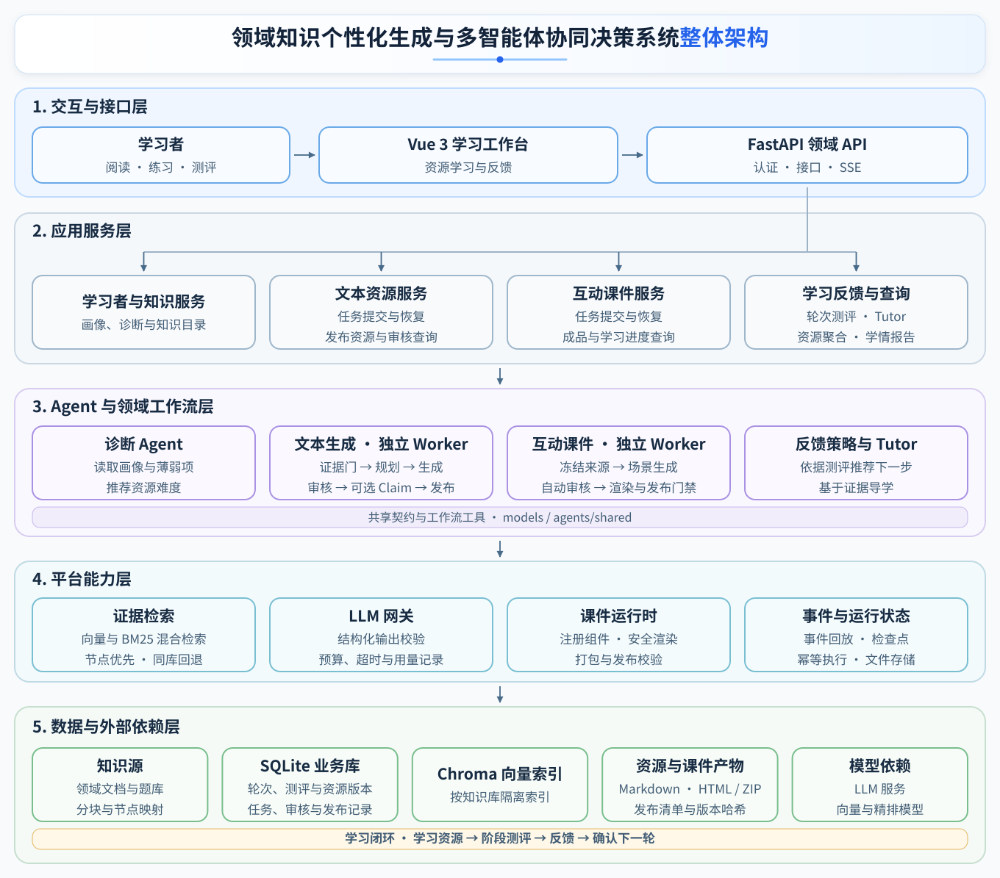

# 领域知识个性化生成与多智能体协同决策系统

**项目编号 XH-202630**

面向领域技能学习者的工作台。系统依据能力诊断确定学习起点，从领域知识库检索证据，生成与当前节点匹配的材料，再通过测评决定下一轮。学习者可以追溯资源来源、查看审核结果，并在系统推荐的补学、巩固或进阶方案中确认下一步。

[快速启动](#快速启动) · [功能说明](docs/features.md) · [系统架构](docs/architecture.md) · [演示手册](docs/demo-runbook.md)

## 能做什么

| 学习任务 | 系统提供的能力 |
|---|---|
| 找到起点 | 从方向问卷了解目标和偏好，结合能力诊断推荐首批学习节点。每个方向有独立画像和学习记录。 |
| 获取材料 | 按当前节点生成讲义、实操指南、分阶测试题、复习清单或案例分析。可查看任务进度、引用来源、审核结果及发布版本。 |
| 阅读与练习 | 在资源架切换同批材料，进入专注阅读或向 Tutor 提问。符合条件的实操指南和复习清单可生成 HTML 互动课件。 |
| 检验学习效果 | 按阶段提交测评，查看节点评分与学习小结。可以再次作答，也可以为需要巩固的节点生成纠错材料和新题。 |
| 安排下一轮 | 结合测评、先修关系和个人选择调整后续目标。历史页保留学习过程，报告展示当前掌握度、学习路径及生成资源质量。 |

**例如**，在「RAG 工程链路培训」中，学习者选定「Chunk 切分」后，可先用讲义理解切分参数，再用实操指南测试参数变化，最后用分阶测试题验证掌握情况。若需要巩固，可以在反馈页确认本轮纠错并生成新题。

## 快速启动

需要 **Python 3.11、Node.js 24 和 npm**。本地运行使用 SQLite、Chroma、FastAPI Web、文本生成 Worker 和互动课件 Worker。

1. **准备新环境**。按部署指南安装锁定依赖，配置 `backend/.env`，准备本地 Embedding 模型并初始化知识库。已有数据环境可直接启动或按指南升级。[首次安装与配置](docs/deployment.md#1-首次安装)
2. **启用轮次**。要体验阶段测评和下一轮选择，在 `backend/.env` 设置 `LEARNING_ROUND_CREATION_ENABLED=true` 后启动服务。模板默认关闭此开关。生成真实资源需配置有效的模型服务凭据。[配置说明](docs/deployment.md#2-配置和初始化)
3. **启动应用**。在项目虚拟环境中，从仓库根运行：

   ```powershell
   python scripts/start_local.py
   ```

| 本地入口 | 用途 |
|---|---|
| [学习工作台](http://127.0.0.1:5173) | 注册或登录，选择学习方向 |
| [FastAPI 接口文档](http://127.0.0.1:8000/docs) | 查看接口和请求结构 |
| [Web 就绪](http://127.0.0.1:8000/health/ready) · [文本 Worker](http://127.0.0.1:8082/health/ready) · [课件 Worker](http://127.0.0.1:8081/health/ready) | 检查服务。任务持续排队时，查看对应 Worker 的状态和日志 |

## 技术结构



- **生成与审核**。检索优先覆盖目标节点，冻结可用证据后再规划和生成。普通审核负责材料质量，支持的资源可启用 Claim 逐条核验事实与缺证补检。
- **服务与数据**。文本和互动课件分别由持久 Worker 执行。资源版本、审核与学习事实可通过任务和轮次追溯。
- **前端与后端**。Vue 3 和 Vite 构建学习工作台，FastAPI 提供认证、业务 API 和任务事件流。[系统架构](docs/architecture.md)

| 目录 | 内容 |
|---|---|
| `frontend/src/features/` | 按业务领域组织的页面与交互 |
| `backend/app/` | API、服务、Agent 工作流、检索、渲染和仓储 |
| `knowledge_base/` | 方向目录、教材、参考来源、技能节点和题库 |
| `scripts/`、`backend/scripts/` | 启动、入库、Worker 和验证工具 |

## 开发与验证

从仓库根运行 `python scripts/run_tests.py --list` 查看可用套件，按改动选择验证范围。例如，使用 `python scripts/run_tests.py --suite learning-round-api` 检查学习轮次接口。[测试指南](docs/testing/README.md)

| 进一步了解 | 文档 |
|---|---|
| 页面和完整学习流程 | [功能说明](docs/features.md) |
| 服务配置、静态构建和升级恢复 | [部署指南](docs/deployment.md) |
| 认证、任务、测评和事件契约 | [API 指南](docs/api.md) |
| 持久化关系和索引维护 | [知识库与数据库](docs/knowledge_base_database.md) |
| 演示流程、比赛指标和真实测试 | [演示手册](docs/demo-runbook.md) · [比赛评测](docs/testing/competition.md) · [评测记录约定](docs/evaluations/README.md) |
| 分支、提交和本地文件管理 | [Git 协作规范](git-workflow.md) |
