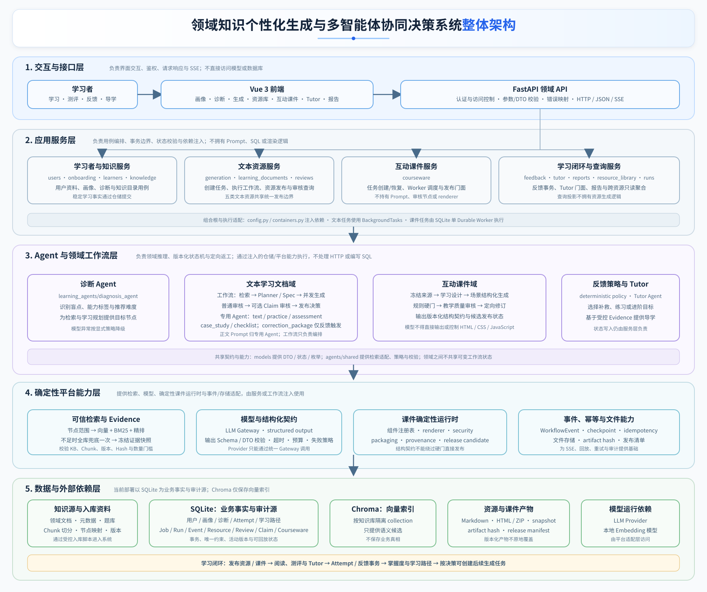
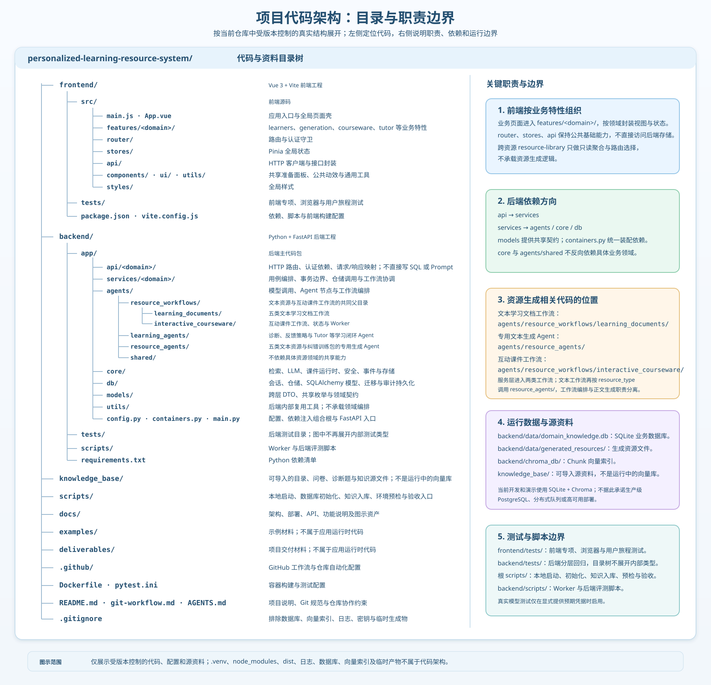
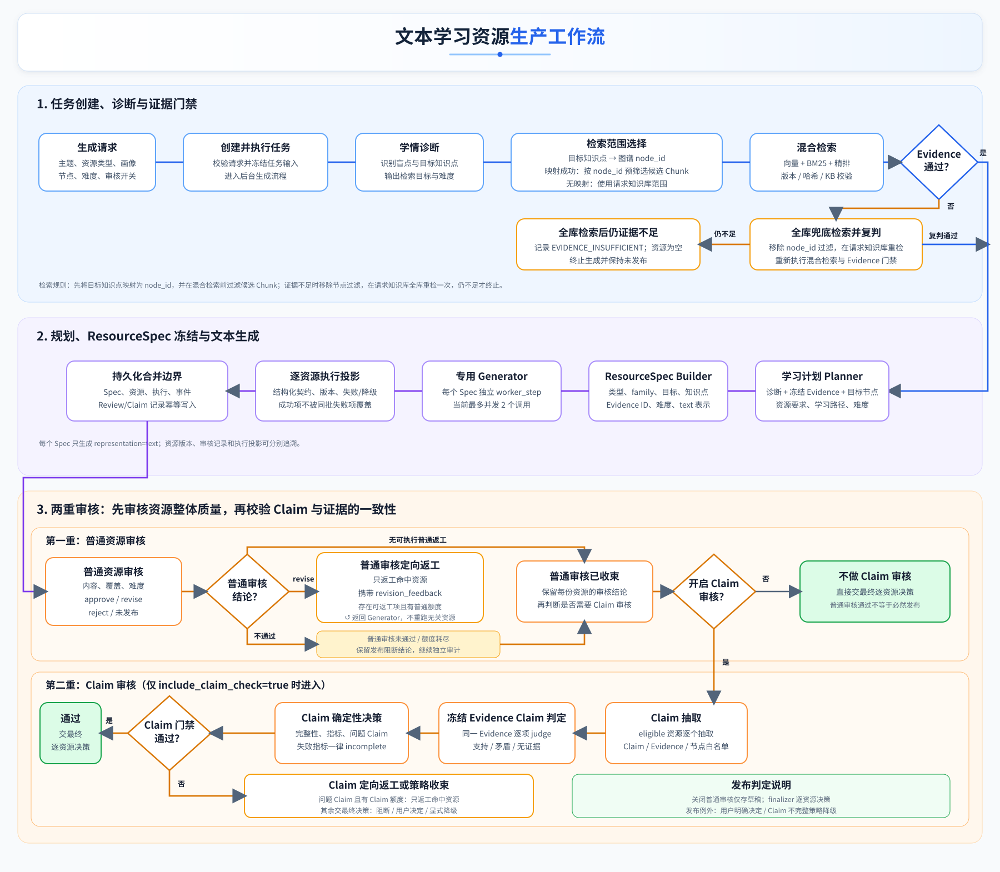
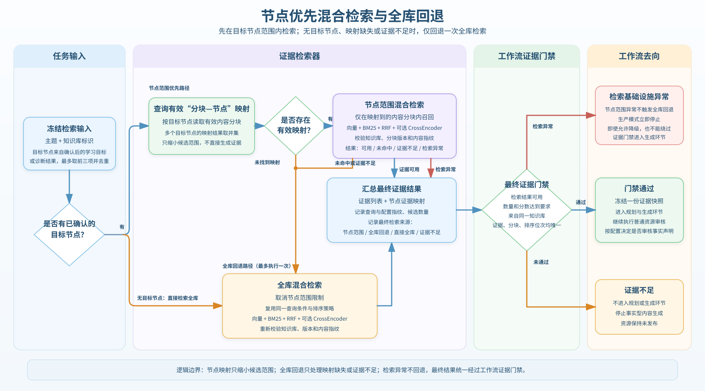
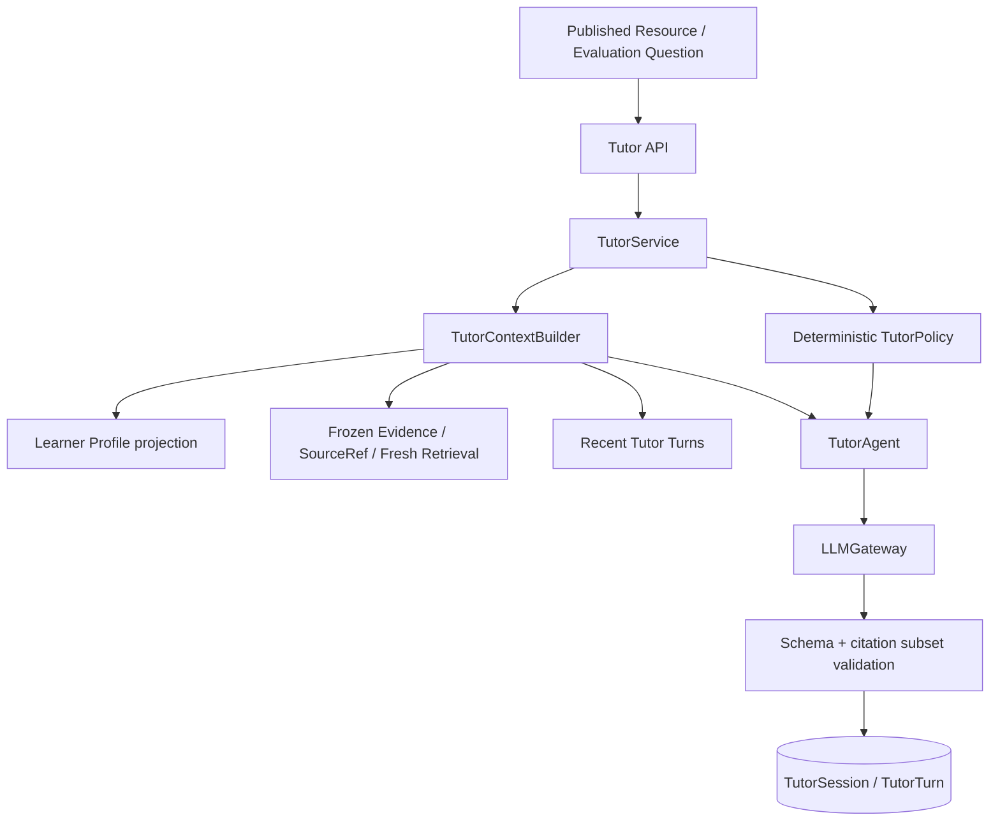

# 总体架构文档

T30讲义教学加工：`resource_agents/lecture_contract.py`拥有`lecture-pedagogy-v1`的受众、篇幅、自包含示例、去重复、通用/项目边界准则及节点显示名投影。TextResourceAgent升级`text-resource-v6-teaching-contract`，只投影Prompt展示文本，不改ResourceSpec、知识点真实ID或冻结Evidence。显示名仅取单一已分配KB的manifest已知目标节点，未知/混合KB不猜。既有reviewer只给讲义的同一次审核追加共享rubric及控制信息，其他资源System Prompt、调用次数、Claim/发布节点不变。这是生成/审核指导，不是新语义硬门，不能由单元测试声称真实模型已消除重复或悬空引用。

T29学习检索：`agents/shared/learning_queries.py`确定性构造任务问题，不调用LLM；retrieve节点仅在legacy学习路径且新开关开启时选择新版本。`vector_store.search_many_evidence_candidates`提供来源预校验后的完整有界20候选，不按owner提前截断；`EvidenceRetriever`继续负责SQL版本/hash、原分门槛、去重，再调用纯`source_balance.py`按节点覆盖及来源软规则选材。来源由可信SQL路径与manifest的id/file/type匹配，分类清单hash纳入config hash。旧接口、Tutor与E1路径不变；新policy候选query_rank允许到min(20, rerank_candidate_k)，其余仍受原TopK约束。没有新表或跨层业务依赖。

T28已激活T27分片文件：`core/retrieval/evidence_chunking.py::markdown_evidence_v2`由`knowledge_base.chunk_documents`按每文档manifest显式选择，旧默认策略不变，新活动资料采用独立身份epoch。策略按同物理页/同能力节点集合聚合教学单元、保代码/表格/数学与真实字符/行号，900目标/1200软限/overlap最多100，共62篇1121片（六教材44片）。离线`scripts/prepare_evidence_chunks.py`分离纯辅助URL并生成parent-context预览；文件激活由`scripts/evidence_corpus_promotion.py`备份、确定性重放及回滚，索引由独立维护入口更新，实际ready以维护receipt为准。父级回填尚未接运行时，Evidence摘录仍最多1200字符，长原子不保证完整入模，不能称已上线父子检索。`provenance/evidence-base`可重建T26，再经`cleaning-base`追溯更早采集基线；两层blob均不索引。

> 项目编号：XH-202630  
> 项目名称：领域知识个性化生成与多智能体协同决策系统  
> 文档版本：2.7
> 文档更新时间：2026-10-25
> 文档定位：描述当前代码库的真实分层、模块边界、运行路径与主流程。

## 0. 整体架构总览



图按“交互与接口 → 应用服务 → Agent 与领域工作流 → 确定性平台能力 → 数据与外部依赖”
五层组织，箭头表示自上而下的调用或依赖关系。API 只调用领域服务；服务负责编排用例、
事务和执行适配，并向 Agent、仓储与平台能力注入依赖。它描述当前本地 SQLite + Chroma
部署的实际代码边界，不表示已完成分布式队列、生产级 PostgreSQL、高可用或自动恢复承诺。

### 0.1 代码架构与目录边界



这张图说明“代码放在哪里、可依赖什么”，而非一次请求的运行时路径。前端按
`features/<domain>` 组织业务界面；后端保持 `api → services → agents/core/db` 的职责边界，
`main.py` 与 `containers.py` 是配置和依赖注入的组合根。`models` 提供跨层稳定的 DTO 和
领域契约；知识库资料、SQLite 与 Chroma 只通过受控的入库、仓储或检索能力访问。

## 1. 架构目标

系统当前面向“多领域培训”场景，围绕以下闭环组织：

```text
注册 / 登录并维护用户资料
-> 领域选择
-> 学习方向选择
-> 初始画像问卷
-> 诊断测评
-> 个性化资源生成
-> 审核与证据
-> 学习反馈
-> 学情报告
```

其中：

- “学习方向”是前台和流程入口概念。
- `knowledge_base_id` 是后端内部的稳定知识边界。
- 用户长期稳定信息由用户资料维护，不再放入通用问卷。
- 问卷负责构建初始画像中的动态学习信息。
- 诊断负责测量真实掌握情况并回写画像。

## 2. 当前代码分层

| 层级 | 目录 | 当前职责 |
|---|---|---|
| 前端界面层 | `frontend/src/` | 用户资料、领域/方向选择、问卷、诊断、历史记录、资源查看、报告展示 |
| API 路由层 | `backend/app/api/` | FastAPI 路由、参数接收、响应模型与错误映射 |
| 业务服务层 | `backend/app/services/` | 用户资料、问卷组装、画像创建、诊断判分、资源生成、反馈处理、报告构建 |
| 多智能体层 | `backend/app/agents/` | LangGraph 工作流及诊断、检索、规划、生成、审核、反馈等 Agent 节点 |
| 基础设施层 | `backend/app/core/` | LLM、Embedding、向量存储、知识库读取、文件存储 |
| 数据访问层 | `backend/app/db/` | 当前 SQLite 仓储、ORM 模型、幂等表初始化与分领域仓储；保留的 PostgreSQL 方言分支属于未验收的可选兼容代码 |
| 数据模型层 | `backend/app/models/` | Pydantic schema 与核心数据结构 |
| 工具层 | `backend/app/utils/` | 项目内部复用工具函数 |
| 脚本层 | `scripts/` | 初始化数据库、导入知识库与问卷/诊断源数据 |
| 知识源层 | `knowledge_base/` | 学习目录源文件、方向知识库元数据、问卷源文件、诊断题源文件 |

## 3. 当前后端模块

### 3.1 API 路由

`backend/app/api/` 按领域包组织。路由实现位于
`admin/`、`auth/`、`courseware/`、`feedback/`、`generation/`、
`knowledge/`、`learners/`、`learning_documents/`、`onboarding/`、
`reports/`、`resource_library/`、`reviews/`、`runs/`、`skills/`、
`tutor/` 和 `users/`；跨路由认证与访问控制依赖位于
`api/dependencies.py`。

说明：

- 画像接口统一收敛在 `/api/profiles/*`。
- 用户基础资料接口统一收敛在 `/api/users/*`。
- 学习历史时间线接口统一收敛在 `/api/learning-history/*`。

### 3.2 服务层

`backend/app/services/` 同样按领域包组织，包含 `auth`、`courseware`、
`feedback`、`generation`、`knowledge`、`learners`、`learning_documents`、
`onboarding`、`reports`、`resource_library`、`reviews`、`runs`、`tutor`
和 `users`。每个包只暴露该领域的用例编排与查询门面。

职责划分：

- `knowledge`、`onboarding`、`learners` 和 `users`：目录、问卷、画像、诊断和用户资料用例。
- `generation`、`learning_documents`、`reviews` 和 `runs`：文本学习文档的任务、发布、审核与运行记录。
- `courseware`：互动课件任务、恢复、发布和 Worker 执行门面。
- `feedback`、`tutor`、`reports` 与 `resource_library`：生成后的学习闭环、只读聚合和资源路由。

Claim 发布检查位于 `services/learning_documents/publication.py`，由 `ResourceService.decide_claim_publication` 暴露；批次续生成位于 `services/generation/continuation.py`，由 `GenerationJobService.create_continuation` 暴露。API 保留权限、健康检查、HTTP 错误适配和最后的后台调度，原提交及事件顺序不变。报告资源可信度分页使用公开 `ReportService.list_resource_credibility`，路由不再组合私有投影方法。

续生成由 `generation/continuation_uow.py` 协调标准仓储：SQL 的 call-local Service/仓储副本共享外层 Connection，Memory 按参与仓储锁顺序持有快照。任务、反馈关联、源任务替代及 mastery/curriculum/tier 准备共同提交；失败回滚，调度失败单独保留同 run 的 failed 任务。容器 Provider 和普通任务创建入口保持。Memory 中绕过仓储锁直接改已返回 profile 的并发写入仍不受协调；混合标准 writer 在首写前拒绝。该边界不提供提交与后台执行间的跨进程精确重放。

反馈和 Claim 从已提交事实补写缺失审计事件，使用稳定 ID 幂等追加；反馈第一条失败即停止后缀，使重试保持顺序。已存在事件的时间与 payload 不变，Claim 保留旧随机 ID 事件。恢复依赖相同业务请求重试，不是自动 outbox Worker。报告和课件 SSE 的同步查询在线程池内创建/释放 Session。

报告读取由 `db/reports/repository.py` 管 SQLite 可见性/keyset 查询与轻量水位读取，`db/reports/watermarks.py` 明确来源闭包；`services/reports/snapshots.py` 管完整语义 revision、时间边界、正文防御性拷贝与进程内有界 LRU/singleflight。`ReportService.build_report` 仍返回原 dict，新增内部 `get_snapshot` 供 GET/流读取 metadata。容器保留原 singleton provider 并注入可选读仓储；只有已知原生 SQL 依赖共用同一 session_factory 且能力/覆盖检查通过才共享快照。未知/混合/Memory/非 SQLite 依赖采用完整语义双读验证，无跨请求缓存。

SQLite trigger 将所有报告来源的增改删与全局 epoch 放进同一事务；安装身份防止重装后的计数重用，构建前后水位一致才发布，首次 mastery 初始化等写入会重试。时间窗口使用下一实际内容边界失效。缓存键包含 learner、owner、knowledge base、窗口和投影版本；容量64、JSON估算总量32MiB、闲置300秒，超大报告不缓存，同 key 累计等待预算10秒。它不跨 Web 进程共享，其他学习者的写入会保守地触发冷重建。API 始终先校验权限，SSE 每轮重检归属；不在缓存或线程之间保存 Session。报告通知不写 durable WorkflowEvent ledger。

服务内确定性职责按同域模块组织：`feedback/assessment.py` 与 `recommendations.py` 管题目/评分及推荐，`reports/projections.py` 管报告区块，`learners/generation_options.py` 管候选投影。原 Service 保留查询、事务、模型调用和公开方法，不增加通用业务层。

`learners/ability_projection.py` 计算已读取快照上的能力节点、客观趋势、课程计数、全图弱项排序和 focus 选择；`MasteryService` 继续拥有仓储读取、目标校验、证据写入、时间与 hash。该纯计算模块不接收仓储或 Session。`feedback_analysis_agent.py` 与 `short_answer_grader_agent.py` 位于 `agents/learning_agents/`，分别持有小结和短答评分的 Prompt、结构化调用及上下文；`FeedbackService` 保留 fallback、异常映射、分数截断/舍入及双评编排。课件场景审核诊断通过 `CoursewareService.get_scene_review` 查询，路由只保留授权、404 和 HTTP 返回，不再直接读取其仓储。具体结构决策和保行为证据见 [2026-10-25 结构优化记录](architecture-optimization-2026-10-25.md)。

课件模型内容契约位于 `models/courseware/content.py`，API/任务 DTO 保留 `models/courseware/contracts.py`；旧 workflow contracts 只提供同一对象的兼容导出，调用者已迁移到 models。shared retrieval 使用 `models/shared/workflow.py` 的 WorkflowState，core 不反向依赖具体工作流。报告雷达纯投影与课件候选的页面修复/渲染校验已提取，外层状态机、硬门顺序和异常边界保持。

### 3.3 Agent 层

`backend/app/agents/` 保持以下边界：

- `resource_workflows/learning_documents/`：五类文本学习文档的工作流和节点。
- `resource_workflows/interactive_courseware/`：互动课件工作流、状态、专用 Agent 与 Worker。
- `learning_agents/`：诊断、反馈策略与 Tutor 等学习闭环 Agent。
- `resource_agents/`：五类文本资源与纠错训练包的专用生成 Agent。
- `shared/`：不依赖具体资源领域的纯共享能力。

当前代码含义：

- Agent 负责协同推理和多步生成。
- 服务层负责把 Agent 与数据库、画像、资源记录串起来。
- 版本化工作流状态、Agent 契约和共享枚举位于 `models/shared/`；资源领域 DTO 位于各自的 `models/<domain>/`。
- 资源不可变投影位于 `models/learning_documents/invariants.py`，仓储不依赖 Agent 校验模块。共享 recorded node 位于 `agents/shared/recorded_node.py`。
- 课件来源准入、确定性组装、版本追踪与 candidate 发布编排位于 `agents/resource_workflows/interactive_courseware/`；来源读取采用同域 `SourceResourcePort`。纯来源追溯和教学质量规则位于 `core/courseware/review.py`。
- 业务课件评测执行器位于 `backend/scripts/courseware_harness/`；`core/courseware/evaluation.py` 保留确定性指标和 fixture 计算。旧 Service 模块及 core 评测入口只保留兼容导出或按需转发，实际实现各有唯一归属；core 的旧 harness 入口是迁移兼容例外。
- 文本资源工作流仅编排 Spec、受限并发、失败隔离、产物物化和 trace；正文 Prompt 位于 `resource_agents/`。
- 公共资源类型词汇由 `models/learning_documents/` 唯一定义。当前路由为 `讲义 -> TextResourceAgent`、`实操指南 -> PracticeGuideAgent`、`分阶测试题 -> AssessmentAgent`、`复习清单 -> ReviewChecklistAgent`、`案例分析 -> CaseStudyAgent`，唯一别名为 `定制讲义 -> 讲义`。
- 反馈闭环可额外创建专属 `个性化纠错训练包 -> CorrectionTrainingPackageAgent`。它在学习文档内部受支持，但不属于普通生成词汇；`FeedbackService` 验证强化候选和快照后才可创建，并只向 Agent 传入脱敏目标、教学策略、达标标准和冻结 Evidence。

课件总工作流保留预算、租约、状态与异常边界，spec 准备、单场景 compose、scene persistence 为具名阶段，`release.py` 通过平台 callback 构建候选产物并经仓储提交。`core/courseware/storyboard.py` 仅执行来源绑定的复习/实操及分页分支，没有模型或数据库调用。

E1 在现有文本 retrieve/plan/generate/review/Claim 节点内接入，节点与边保持。`agents/shared/retrieval.py` 拥有公共／类型查询规则；`core/retrieval/vector_store.py` 保留多查询命中并固定候选 owner，`resource_allocation.py` 在来源／分数校验后选择 C/S；版本化 `models/knowledge/knowledge.py::EvidenceAllocation` 绑定 step、config、E、类型和查询指纹。运行 state/snapshot 显式传递，trace 经 complete_step 与 Evidence 一同写入，checkpoint 保存 ID／映射且继续受64KiB限制，不复制正文或增加SQL列。Planner 在新模式只读全部最终 E 一次；`agents/shared/evidence_scope.py` 集中校验资源 spec 的 A 与节点交集，生成、审核、Claim、来源和返工统一使用原范围。旧spec尊重原ID，旧快照默认legacy；新模式缺分配或越界失败关闭。开关及窗口条件见 [部署说明](deployment.md)，实际验收见 [T26](update_plan/T26.md)。

课件运行资产由平台维护在 `core/courseware/assets/theme.css` 与 `runtime.js`，`runtime.py` 按自身路径读取 UTF-8 并归一为 LF，继续导出原 `STYLE`、`SCRIPT` 和版本常量。Renderer 仍将它们嵌入 HTML；资产提取保持原字节及 CSS 覆盖顺序，不引入外部请求、模型生成代码或新运行版本。详见 [资产说明](../backend/app/core/courseware/assets/README.md)。

### 3.4 前端业务与公共界面层

前端入口由 `main.js` 注册 Vue Router、Pinia、Element Plus 和 `v-module-motion`；`App.vue` 负责学习外壳、侧栏折叠与页面动效。业务页面已经迁入 `features/<domain>/`，旧 `src/views/` 不再保存业务页面。

| 目录 / 入口 | 当前职责 |
|---|---|
| `features/auth/` | 六屏公开首页和共用登录/注册弹窗；`/login`、`/register` 复用 `LandingView` |
| `features/home/`、`home/showcase/` | 登录后工作台和公开首页的四项本地机制示意 |
| `features/onboarding/` | 领域、方向、问卷、诊断、资源确认五步引导 |
| `features/learners/` | 用户资料与学习历史；历史页以 `journey` 聚合学习轮次 |
| `features/generation/`、`features/runs/` | 资源生产工作区、运行事件 SSE、持久化轨迹和轮询降级 |
| `features/learning-documents/` | Markdown 阅读、来源展示、资源切换与 `focus=1` 专注模式 |
| `features/courseware/` | 单资源课件任务、来源选择、进度、iframe 预览和学习事件 |
| `features/feedback/`、`features/tutor/` | 批次 / Run 正式测评、下一步确认和证据约束导学 |
| `features/reports/` | 报告 4.1 快照、ETag、报告 SSE 与四类 ECharts 展示 |
| `features/resource-library/` | 文本与课件的只读书架 API 聚合 |
| `api/`、`stores/` | 带 Cookie 的 HTTP 客户端、旧 API 入口兼容导出、认证状态、当前画像与方向上下文 |
| `components/`、`ui/`、`styles/` | 公共准备面板、页面 / 模块动效和主题；不承载生成或判分规则 |

公开首页的 Agent、证据、路径和反馈场景采用本地示意数据；实际生成页读取持久化事件。学习页面中的画像和时间窗口切换会使旧请求、分页及更新流失效，迟到响应不能覆盖当前上下文。布局按可用空间选择固定框架、区域内滚动或自然阅读；动画遵循 `prefers-reduced-motion`，相关浏览器专项由 `tests/suites.json` 管理。

HTTP 端点实现统一归所属 `features/<domain>/api.js`，Run 查询沿用 `features/runs/queryApi.js`；画像、用户资料、诊断和历史 API 跟随现有 `learners` 界面归属。领域模块只使用共享 `api/client.js` 创建的 Axios 实例；页面、store 和 composable 直接导入实际所属域，`api/index.js` 保留全部15个旧导出的同对象转出，不实现业务端点。报告旧 `reportApi` 和带窗口/ETag/校验的 `learningReportApi` 各保留原契约。ESLint 阻止内部静态导入集中兼容入口，允许同域 `./api` 和跨域公开 API。

生产页面按实际职责提取同域 composable：GenerateView 使用 `useGenerationProgress`、`useGenerationClaims`、`useProductionLayout`；FeedbackView 使用 `useFeedbackEvaluation`、`useFeedbackFollowup`；CoursewareGenerationWorkspace 使用 `useCoursewareTracking`。页面持有共享状态，watch/mount/unmount 注册顺序与模板保持；旧 `useCoursewareJob` 留作兼容 helper，其任务历史和终态通知时机不与生产 hook 混用。

`styles/selects.css` 由 `main.js` 在主题后加载，统一 Element Plus Select、Teleport 下拉菜单及原生单选 select 的视觉 token、焦点和选中状态。领域页面只保留选择器布局/宽度及必要高度适配，不重复覆盖圆角、背景和焦点。菜单样式限定真实 Select/Dropdown 类，普通输入框、Tooltip/Popover 与课件 iframe 资产沿用各自规则；所有业务绑定与原生键盘行为保持。


## 4. 当前主流程调用链

### 4.1 用户资料、画像与诊断

```text
frontend
-> POST /api/auth/register 或 POST /api/auth/login
-> PATCH /api/users/{user_id}（按需维护本人资料）
-> GET /api/knowledge/domains
-> GET /api/onboarding/questions?learning_direction_id=...
-> POST /api/onboarding/initial-profile
-> POST /api/diagnosis/submit
-> users / learner_profiles / questionnaire_* / diagnostic_* 落库
```

说明：

- 用户的 `identity`、`education`、`major` 等稳定信息先进入 `users`。
- 认证使用 HttpOnly Cookie；私有路由校验用户与画像归属。挂载到主应用的 `POST /api/users/` 是兼容路由，已登录请求返回 403，公开创建账号使用注册接口。
- 通用问卷只负责当前学习方向的动态信息，不再重复采集稳定资料。
- `onboarding_service` 会优先使用用户资料中的 `identity` 回写画像的 `learner_type`。

### 4.2 生成与反馈

```text
frontend
  -> HTTP
backend/app/api
  -> 调用服务
backend/app/services
  |- generation_job_service: 创建异步任务、查询状态、后台执行
  |- generation_service: 先执行 readiness gate，再调用多 Agent 生成闭环并保存资源
  |- feedback_service: 提交正式 Attempt，执行确定性反馈策略并协调事务与后续生成
  |- learning_path_policy: 校验并生成路径状态变更
  |- report_service: 聚合画像、资源、Attempt、版本历史和持久化路径
  ->
backend/app/agents
  |- diagnosis: 学情诊断 Agent
  |- retriever: 知识库检索 Agent（BM25 + Chroma 向量召回 + RRF 融合 + CrossEncoder 精排）
  |- planner: 学习路径规划 Agent
  |- generator: ResourceSpec 编排与受限并发，不持有通用正文 Prompt
  |- resource_agents: 按 resource_type 精确路由的专用生成 Agent
  |- reviewer: 审核纠偏 Agent
  |- feedback: 反馈决策 Agent
  |- claim_review: 独立 Claim 抽取、冻结 Evidence 判定与确定性指标
  |- workflow: 审核开关、Claim 返工闭环、返工额度与终态决策
  ->
backend/app/core + backend/app/db
  |- RuntimeHealth / failure policy / LLM / Embedding / ChromaDB / 知识库 / 文件存储
  |- Repository / ORM / SQLite or Memory
```

生成请求进入工作流前，由 `generation_service.build_workflow_state()` 完成唯一映射并生成 `run_id`。当前对外生成入口已经统一为异步任务模式：

```text
POST /api/generate/jobs
-> GET /api/generate/jobs?learner_id={learner_id}
-> 同事务持久化 job、冻结请求/画像与 mastery 调度（SQLite）
-> 独立 generation_worker.py 原子领取，GenerationJobService.run_claim(...)
-> 任务状态通过 GET /api/generate/jobs/{run_id} 查询
-> 结果通过 GET /api/resources/{learner_id}?run_id={run_id} 获取
```

SQLite 文本任务归 `generation`：`db/generation/dispatch.py` 管原子领取、owner/epoch 续租、唯一重试链与有界对账；`services/generation/worker.py` 管并发 1 的执行与持续 heartbeat。`core/execution.py` 只保存通用执行上下文，SQL flush/commit 隔离位于 `db/generation/fencing.py`，资源线程用 `copy_context` 保留归属。API 经 Service 保存冻结输入，不写 SQL 或运行模型。旧 legacy 无 Run 任务才适用排队年龄阈值；running 以 AgentRun 的租约和终态判断。开始前故障可重领，开始后过期明确中断，新尝试不复活旧终态。文本检查点没有自动重建/续跑入口。

单份手动重生成（T23）是独立的新 Run 用例，不是恢复旧检查点执行：`services/generation/resource_retry.py` 校验终态任务、spec/执行项、源 dispatch、checkpoint 和冻结 Evidence 后构造内部 `ResourceRetryContext v1`；`GenerationJobService.create_resource_retry` 在既有 UOW 创建同 batch 的幂等任务，不重算画像焦点。可信上下文只存 dispatch_snapshot，使用 `learning_documents.resource_retry.v1` 分发版本，Worker/background 都校验版本与 context 双向一致性，缺失或损坏拒绝，不退回正常诊断。

文本图新增条件入口：普通任务仍 `diagnose`，单份重生成经记录节点 `reuse_context -> generate`，跳过 diagnose/retrieve/plan，后续审核、Claim、发布沿原图。导入节点将源 Evidence 克隆到新 Run/step（新 ID/hash），重映射单份 spec 和 E1 分配并保持原范围；新 spec ID、旧 family，旧正文只经 regeneration_source 供生成参考，不混入新 Run 产物。RecordedNode、DurableWorkflowRunner、WorkflowArtifactRecorder 照常持久化新步骤、证据、版本和审核。旧请求没有完整冻结上下文返回 409；原批次 continuation 和整任务 retry 行为不变。

Worker 在监护循环内处理续租与对账异常，当前线程仍运行时不返回新领取路径；异常期间 readiness 失败，成功续租/对账后恢复。明确 lease-lost 则停止领取，并保留错误原因；异常路径也检查既有退出预算。

普通创建、continuation 和 durable feedback 使用同一连接的短事务绑定 job、mastery 与必要关联/事件；SQLite `BEGIN IMMEDIATE` 在决策读取前取得写锁，避免并发重复调度。已发布文本文件不可原位改写；SQL 拒绝失效执行者的资源、审计、checkpoint 和发布提交。

运行中遵守以下控制流：

```text
diagnose -> retrieve -> plan -> generate
                                  |- include_review=false -> finalize_draft
                                  |- include_review=true  -> review
                                                               |- (可重试生成失败 / revise) 且有普通额度
                                                               |     -> prepare_revision -> generate
                                                               |- 无普通返工 + Claim 开启且有 eligible 资源
                                                               |     -> claim_extract -> claim_judge -> claim_decide
                                                               |            |- 问题 Claim 且有 Claim 额度 -> prepare_revision -> generate
                                                               |            |- 其余 -> finalize（逐资源发布策略）
                                                               |- 其余 -> finalize
finalize -> END
```

资源生成内部链路：

```text
GenerateRequest 请求校验与类型规范化
-> ResourceSpec Builder 冻结 type/family/evidence/knowledge points/budget
-> Generator 为每个 Spec 分配独立 worker_step_id，并以最大并发 2 调用专用 Agent
-> Reviewer 按文本资源独立审核；Claim 启用时也按资源调用
-> 已批准资源立即发布，不等待同批其他资源
-> 已批准且已发布的资源可立即阅读
```

每个文本资源仅保留 `representation=text`。数据库以 `(run_id, resource_spec_id, representation)` 唯一标识当前执行投影，以 `(run_id, resource_spec_id, representation, version)` 约束资源版本。关闭普通审核时只保存未发布草稿；普通返工与 Claim 返工分别受 `max_iterations`、`claim_max_iterations` 约束，后者默认 `0`。

Claim finalizer 保留完整通过、硬阻断、待用户决策和显式 partial 降级的区别：无证据事实满足阈值时可等待用户决定；`CLAIM_PARTIAL_PUBLISH` 仅控制符合条件的审核不完整资源，保留 `incomplete` 指标。默认配置与模板差异见 [部署说明](deployment.md)，不能把这些发布例外表述为完整 Claim 审核通过。

### 4.2.1 当前资源生产流程



本图当前只说明文本学习资源生产。节点优先检索只在有目标节点时缩小候选范围；无映射、无命中或证据不足会回退一次全库检索。回退后仍不满足 Evidence 门禁时，工作流停止事实型生成；底层检索错误则保留原有错误语义，而不是以回退掩盖故障。普通审核返工优先于 Claim；普通审核 reject / human_review 不阻止 eligible 资源的独立 Claim 审计，发布时仍保留原阻断结论。关闭普通审核只保存草稿；发布由 finalizer 逐资源决策，区分完整通过、用户明确决定和符合配置的 Claim 不完整降级。

### 4.3 P0-07 反馈后真实闭环

```text
POST /api/feedback/attempts/run/submit 或 /api/feedback/attempts/batch/submit
-> 校验 learner、published source resource/version、冻结题目、知识点与服务端判分证据
-> 读取 profile_version、knowledge state、最近趋势和当前 path
-> deterministic policy
   |- overall < 0.60 或任一点 < 0.60 -> remediate
   |- 0.60 <= overall < 0.80        -> practice
   |- overall >= 0.80 且无 blocker  -> advance
-> Transaction A
   |- learning_attempts + point_results
   |- feedback_decisions
   |- knowledge_states + mutation history
   |- learner_profiles.profile_version + version history
   |- learning_paths/nodes + path mutation
-> commit
-> 返回反馈报告和下一步候选，不自动创建新任务
-> 学习者通过 POST /api/feedback/followups/select 确认节点 / 纠错方案
-> 幂等创建现有 generation job
-> 保存 parent run / attempt / decision / child run 关系
-> 独立文本 Worker 消费同事务提交的生成任务（memory 保留 BackgroundTasks）
-> 新 Run 继续经过 Evidence、Review、Claim Audit 和 Publication Gate
```

知识点掌握度采用可解释 EWMA：已有状态为 `0.2 * old + 0.8 * attempt_score`，让最近一次客观测评占主要权重；无既有分数或自评先验时，首次客观测评直接取本次得分。规范掌握态的先验和证据门槛见第 14 节。hint 与 duration 仅进入决策上下文和审计，不暗中改变 mastery。每次成功更新将画像版本从 N 变为 N+1，并以 `expected_profile_version` 做 CAS；重复请求不会再次加权。

路径 mutation 由 policy 生成并校验自环、缺失前置条件、环路和重复节点。低分插入/复用 remedial，中分插入/复用 practice，高分完成当前节点并解锁满足前置条件的下一节点；无下一节点时增加 challenge。路径只有实际变化才递增版本。

旧 `POST /api/feedback/attempts` 接收聚合分数但缺少可信题目证据，返回 422 `FEEDBACK_EVIDENCE_UNVERIFIED`；它不写掌握度、路径或画像版本。

Follow-up 属于确认选择后的 after-commit 副作用。Claim 关闭时一次选择保持单 Run 多资源；Claim 开启且多资源时按资源类型创建独立 Run。每个 Run 绑定同一 Attempt/Decision；资源页追加创建 `continuation` 关系，失败重试创建新的 `retry` 关系并保留失败来源。创建失败时 Attempt 保持 `applied`、关联状态为 `failed`，相同幂等请求可安全对账重试。反馈事件只存稳定 ID、计数、分数摘要、action/reason code 和版本，不保存完整答案、画像、Prompt 或模型原文。

### 4.4 P0-08 WorkflowEvent SSE

```text
业务动作 / Agent step
-> 资源、审核、Claim、状态事实先持久化
-> WorkflowEvent append + commit
-> RunEventStreamService 短事务查询 event_sequence > cursor
-> public allow-list mapper
-> StreamingResponse(text/event-stream)
-> EventSource
-> sequence-deduplicating reducer
-> AgentVisualization realtime timeline
```

WorkflowEvent Ledger 是唯一事件事实源，SSE 只是只读 transport，不创建第二套 UI event 表或进程内 progress ledger。每个 SSE poll 都打开并关闭独立 Repository Session，不在长连接期间持有数据库事务或行锁；同步 SQL 查询通过 thread offload 避免阻塞 ASGI event loop。

连接先发 snapshot，再补发 durable event backlog，最后 live tail。浏览器断线只停止观看，不取消 Worker/Workflow；重连使用原 EventSource 的 `Last-Event-ID`，或页面刷新后以 timeline 最后 sequence 作为 `after_sequence`。heartbeat 不进入 Event Ledger。两个客户端独立读取同一 append-only ledger，不存在 delivered/ack 或破坏性消费。

GenerationJob/AgentRun 的 queued 竞态保持现有 ownership：Job 可先存在，SSE snapshot 此时 run_status 为空并等待 AgentRun。P0-08 没有引入 Redis、消息队列、WebSocket、自动 resume/cancel 或 token streaming。

资源事件 payload 只公开 `resource_spec_id`、`resource_family_id`、`resource_type`、`representation`、`resource_execution_state`、`worker_step_id`、`resource_id`、`review_id`、`agent_name`、`prompt_version`、`artifact_format`、`validation_status` 和安全错误码等白名单字段；不下发正文、Prompt 或模型原始响应。

前端 `features/generation/WorkflowExecutionGraph.vue` 先按真实步骤序号计算每次调用次序，再按有效序号稳定倒序呈现，缺编号记录置后，复审/返工不聚合；SVG 曲线按实际节点锚点测量绘制，从较旧下方节点指向较新上方节点，仅表示记录顺序，不推断因果或并行关系。浅色画布用左侧轻错位业务图形、统一文字列和状态文字呈现，无第三方图编辑依赖；新记录仅影响process-scroll，顶部跟随、历史保持可见step_id/偏移，状态更新不重置。AgentVisualization按Run设置key，重建局部状态并沿用切Run回顶；关键节点沿用原只读详情入口，辅助与未知节点被动展示。`useGenerationAudit.js` 通过只读 timeline/claims 加载审核制品，使用请求上下文守卫隔离画像、Run 和晚到响应；timeline 的完整 steps/reviews/resource_versions/evidence 不受事件分页限制，既有事件回放仍由 progress hook 分页。`generationAudit.js` 负责 Claim 与判定身份校验、同 Run 冻结 Evidence ID 关联、资源版本族和线性变化范围投影；`WorkflowDetailDialog.vue`、`workflow-detail/` 叶子组件与 `ClaimEvidenceList.vue` 只展示，不调用模型或改变发布状态。旧 Claim 报告复用同一证据组件，发布入口沿用原 Service 契约。对应界面行为由生成页浏览器专项验证。

`features/generation/resourceStatusPresentation.js` 统一请求占位、spec 分组和同产物发布投影，仅派生显示数据，不写入 execution ledger。卡片、计数、重试入口与 Claim 发布报告共用这一口径。事件 reducer 使用有限的真实回放水位与持久项时间，稀疏同次事件保留未提供字段，新 attempt 清除旧产物/错误/核验信息；人工发布的资源投影独立于执行记录时间戳。

T15 建立完整 trace 图形链路并移除重复的生命周期日志UI；T17 将唯一资源状态区域置于轨迹上方常显，从真实请求类型占位过渡到执行记录。AgentVisualization仅展示图形链路、资源交付与按真实childRuns显示的独立后续生成导航，reducer事件保存不变；交付列表采用浅灰底面的独立白色资源article，以细边界和间距明确每份产物归属；状态横排，操作按内容宽度横排/按需折行，使用短可见文案并保留完整aria-label与原发射事件。校验、发布、生成次数及 Agent 记录在卡片主体常显，技术审计保留原过程详情入口。ResourceExecutionProgressList保留spec分组/text优先/状态优先级和原按钮条件，阶段审核、publication与Claim状态分别显示；不把审核通过或Claim完成当作已发布，汇总既有多表示口径未变。待决定提示与发布结果按同resource_id读取当前资源本体和报告中的显式决定，再补执行字段；已确认发布清除过期待决定，不改变发布规则。历史执行项缺少时间时，状态刷新按需读取现有timeline查询取得有限水位。`workflowPresentation.js` 集中维护真实关键节点与明确历史 agent 别名的展示/详情白名单，图与详情 hook 共用；已有未知 node_name 不借 agent 别名提升为可交互节点。`associatedStepResources` 仅使用同 Run 的显式 resource_ids 或 review_ids 关联资源；没有关联的诊断/规划等节点不自动选择其他产物。详情分开执行状态、普通审核和事实判定。`WorkflowDetailDialog.vue`管理通用外壳、加载/刷新、显式资源选择和唯一body滚动；无tablist/tab/tabpanel或模块切换。`workflowDetailPresentation.js`管理六项职责与唯一contentKind、受控公开摘要投影/未知全文回退；`workflow-detail/`的结果、普通审核、冻结证据、版本叶子按职责渲染单页，CSS仅作用于详情。诊断展示难度/盲区/建议，检索展示明确引用的冻结来源，规划仅投影最多四项保存摘要，生成展示显式关联版本正文，审核展示真实Review及已保存摘要/decision_reason，Claim核验展示真实判定与来源对照。evidence_gate/claim_extract被动，仅图内状态，不再重复检索/核验正文；不同调用/版本的同角色不按名称去重。资源入口只展示普通审核和默认折叠的显式版本对比，旧独立Claim发布报告保持。已删除不再使用的导航/抽取详情实现，不保留转发。`workflowNodeIcons.js`共用14个既有图形与未知图形。底部执行上下文/输入/标识默认折叠；多资源节点选择放在主体前，单资源选择折叠。接口未保存完整诊断/规划或逐资源模型suggestion时不补造；审核聚合说明不称原始模型回复，执行成功不等于审核通过。ClaimEvidenceList可选focusFirst仅详情启用，按记录顺序优先contradicted/not_in_evidence/incomplete，无问题时首条，non_factual不抢占问题，旧发布报告默认折叠。冻结来源、版本身份、请求隔离和发布边界不变，呈现不改变判定或发布。

P0-06 的 Claim 抽取器与 Generator 相互独立。模型只能从资源、目标技能节点和当前
Run 的冻结 Evidence ID 白名单中选择；代码负责生成稳定 Claim ID，并校验原文跨度、
资源版本、知识点与 Evidence 边界。判定失败、漏判或伪造 ID 均 fail closed 到
`human_review`。新资源版本必须重新抽取，旧版本判定不会复制。

`max_iterations` 是普通审核最大返工次数，不包含初次生成；Claim 使用独立的 `claim_max_iterations`。`generation_attempt = revision_count + claim_revision_count + 1`，技术重试不复用该计数。每次运行、节点执行、资源版本和资源审核分别使用 `run_id`、`step_id`、`resource_id`、`review_id`，ID 在动作开始或结果产生时生成，持久化层不重新生成已有 ID。

### 多 KB collection 与健康检查边界

- 每个 `knowledge_base_id` 通过 `backend/app/core/retrieval/vector_store.py:_collection_name()` 映射到独立 Chroma collection。
- collection 的创建、写入、查询、删除和 health 均复用该 resolver，`CHROMA_COLLECTION_NAME` 兼容期只作为前缀，不再表示唯一固定集合。
- 公共 `/health` 与 `/health/ready` 只判断默认 KB 和 Python、storage、LLM、Embedding、Chroma 目录、资源目录等核心依赖。
- 管理员 `/api/admin/knowledge-bases/health` 在显式 token 保护下返回所有 KB 的脱敏详情。
- 默认 KB 正常但部分可选 KB 异常时，管理员汇总为 degraded；公共服务不因此返回 503。默认 KB 或 Chroma 核心不可用时才按运行模式进入 degraded/not-ready。

## 5. 当前接口闭环

当前实际对外闭环接口为：

```text
POST /api/auth/register 或 POST /api/auth/login
-> GET /api/knowledge/domains
-> GET /api/onboarding/questions
-> POST /api/onboarding/initial-profile
-> POST /api/diagnosis/submit
-> POST /api/generate/jobs
-> GET /api/generate/jobs?learner_id={learner_id}
-> GET /api/generate/jobs/{run_id}
-> GET /api/resources/{learner_id}
-> GET /api/resources/file/{resource_id}
-> GET /api/feedback/evaluation/batch/{learner_id}/{batch_id}
-> POST /api/feedback/attempts/batch/submit
-> POST /api/feedback/followups/select（确认后续学习方案）
-> GET /api/feedback/attempts/{learner_id}
-> GET /api/learning-history/{learner_id}/journey
-> GET /api/report/{learner_id}
```

补充接口：

- `GET /api/users/`
- `GET /api/users/{user_id}`
- `PATCH /api/users/{user_id}`
- `GET /api/knowledge/directions`
- `GET /api/knowledge/info`
- `GET /api/skills/nodes`
- `GET /api/diagnosis/questions`
- `GET /api/reviews/{resource_id}`
- `GET /api/generate/jobs?learner_id={learner_id}`
- `GET /api/feedback/evaluation/run/{learner_id}/{run_id}`
- `POST /api/feedback/attempts/run/submit`
- `GET /api/feedback/attempts/{learner_id}`
- `GET /api/evaluation/summary`

## 6. 当前数据与运行目录

| 路径 | 当前用途 |
|---|---|
| `backend/data/domain_knowledge.db` | SQLite 业务数据库 |
| `backend/data/generated_resources/` | 生成资源文件目录 |
| `backend/chroma_db/` | Chroma 向量索引目录 |
| `backend/logs/` | 运行日志目录 |
| `knowledge_base/learning_catalog_seed.json` | 领域与学习方向目录源文件 |
| `knowledge_base/questionnaire_common.json` | 通用问卷源文件 |
| `knowledge_base/<track>/questionnaire.json` | 方向特定问卷源文件 |
| `knowledge_base/<track>/diagnostic_questions.json` | 方向诊断题源文件 |

说明：

- 默认数据库路径来自 `backend/.env.example`；实际路径由本机配置决定，迁移状态须用只读完整性检查核实。
- `knowledge_base/questionnaire_common.json` 现已收缩为只保存动态学习信息，不再包含用户长期资料字段。

## 7. 当前目录树摘要

```text
backend/
  app/
    api/
    agents/
    core/
    db/
    models/
    services/
    utils/
    config.py
    main.py
  data/
  chroma_db/
  logs/

frontend/
  src/
    api/
    components/
    features/<domain>/
    router/
    stores/
    styles/
    ui/
    utils/

knowledge_base/
  learning_catalog_seed.json
  questionnaire_common.json
  rag_engineering_training/
  demo_industrial_internet/

scripts/
  init_db.py
  ingest_knowledge.py
```

## 8. 当前约束

### 8.1 命名约束

- 前台流程入口使用 `learning_direction_id`
- 后端内部知识边界保留 `knowledge_base_id`
- 用户资料主键使用 `user_id`
- 学习者画像主键使用 `learner_id`

### 8.2 文档约束

当以下内容变更时，应同步文档：

- 路由文件名或接口路径
- 服务命名
- 主流程步骤
- 数据库存储位置
- 用户资料、问卷与诊断的数据边界

### 8.3 运行约束

- 项目本地接口基地址统一为 `http://127.0.0.1:8000`
- Vite 前端代理应指向 `8000`
- 文档与联调口径均以 `8000` 为准
- 互动课件任务由 `backend/scripts/courseware_worker.py` 的独立 Durable Worker 消费；Web 生命周期不执行课件工作流
- 当前 SQLite 课件链路只运行一个顺序 Worker，默认健康端点为 `http://127.0.0.1:8081`；`/health/ready` 表示完成过持久 outbox 轮询。文本任务另有唯一 `generation_worker.py`，健康端口为 8082
- 一键本地启动入口为 `python scripts/start_local.py`，完整操作与停机语义见 `docs/deployment.md`

### 8.4 当前实现边界

- 当前对外资源生成模式为异步任务模式
- 同步生成接口 `POST /api/generate/` 已移除
- 资源生成页当前按任务维度展示，默认定位当前任务，可切换查看历史成功任务
- 学习反馈页优先按批次加载测评；纠错包重新验证使用独立 Run；下一轮生成须由学习者确认
- 学习历史页面优先依赖 `/api/learning-history/{learner_id}/journey`；`timeline` 保留兼容
- 通用问卷不再承担用户资料采集职责
- P0-09 runtime 前端探针已适配现行目录，仅核对源码连线；TestClient lifespan 会初始化数据库和启动对账，须在隔离 demo 环境执行，详情见 [Demo Runbook](demo-runbook.md)

## 9. Agent 可靠执行与异步任务整合

dev 的异步 `GenerationJob` 负责排队和面向前端的任务状态；`AgentRun` 负责一次
多 Agent 执行的可信生命周期。两者共享预分配的 run_id，但职责不合并：

```text
GenerationJobService
  -> GenerationService.generate_with_run_id
       -> AgentRun / AgentStep / WorkflowEvent
       -> EvidenceRetriever
            -> target_skill_nodes ? node-scoped hybrid : global hybrid
            -> no_hit / evidence_insufficient ? global hybrid fallback
            -> vector + BM25
            -> optional CrossEncoder rerank
            -> KB / Chunk version / content hash validation
       -> Generator
       -> Reviewer
       -> WorkflowArtifactRecorder
       -> WorkflowCheckpoint
       -> publication gate
```

架构约束：

- 只要请求带有冻结的 `target_skill_nodes`，Retriever 先通过 SQL 的活动 Chunk—节点映射缩小候选范围；请求未带目标节点时保持原有全库混合检索。目标节点来自已确认的学习目标/诊断结果，不在 Retriever 内额外调用模型分类。
- 节点范围检索将同一知识库、多个目标节点对应的活动 `chunk_id` 取并集，并将这一份白名单同时传给 Chroma 向量召回、BM25 和 CrossEncoder 精排；不会先全库召回、再在末尾过滤。
- 节点范围没有有效映射，或其结果为 `no_hit` / `evidence_insufficient` 时，系统用相同查询和既有 policy 执行一次全库混合检索。节点范围发生 `retrieval_error` 时保留原有错误/降级语义，不用全库回退掩盖基础设施故障。
- 混合召回和精排只产生候选；候选必须经过 SQL Chunk 历史版本、KB 范围和内容哈希校验后才能成为 Evidence。
- 每次检索只保存一个不可变 Evidence snapshot；`skill_node_id -> evidence_ids` 是该快照的节点命中投影，同一 Evidence 可属于多个节点。节点范围成功时 snapshot 来自节点范围；发生回退时 snapshot 来自全库，资源来源结构与前端展示均不变。
- 检索 profile 与 Workflow trace 记录最终来源：`node_scoped`、`global_fallback`、`global` 或 `evidence_insufficient`，并记录节点映射候选数和回退原因，供运行审计而非对外 API 契约使用。
- `RecordedNode` 在节点副作用前创建 running Step；`DurableWorkflowRunner` 在状态合并后、checkpoint 前保存业务制品。
- Generator 定向返工将上一版本原文作为 `previous_version_content` 与结构化指令一并传入；仅重生成命中的资源类型，新版本不可原地覆盖旧正文。
- Reviewer 的模型建议必须经过确定性 policy 二次裁决。
- Resource 的 `run_id` 单一关联 AgentRun；GenerationJob 以同值关联，避免 ORM 中出现两个竞争的 run_id 字段。
- `review_status` 描述审核状态，`publication_status` 描述分发状态；只有最终批准叶子版本发布。
- Run 回放只读数据库，不重新执行模型；P0-08 已增加基于持久化 WorkflowEvent 的 SSE replay/live tail，自动 resume 与取消仍不在 P0 范围。

### 9.1 模块级节点优先检索与全库回退



当前第一阶段采用模块级映射，而非人工逐 Chunk 标注：一个模块内的所有 Chunk
映射到该模块在 `metadata.json` 中声明、且与 `rag_skill_nodes.name` 精确匹配的
能力节点。映射的职责只是缩小候选范围；范围内仍由语义相似度、关键词、RRF 和精排
判断哪一段内容最相关。因此它不会承诺“每个 Chunk 只属于一个节点”，也不替代
Evidence 的来源、版本和哈希校验。

公开 `GenerateRequest` 最多接受两个同阶目标节点；共享检索器另对工作流状态中的目标保留前三项去重上限，不会因此扩大公开请求契约。运行顺序如下：

```text
target_skill_nodes 非空
  -> 查询活动 Chunk—节点映射并取多节点并集
  -> 在该 Chunk 白名单内执行向量 + BM25 + RRF + CrossEncoder
  -> 通过现有相关度、证据数量和来源校验？
       是：冻结 node_scoped Evidence
       否（无映射 / no_hit / evidence_insufficient）：执行一次原全库检索
  -> 全库结果仍不足：沿用 Evidence Gate，停止事实型生成

target_skill_nodes 为空
  -> 直接执行一次原全库检索
```

`min_evidence_count`、归一化相关度和最大 Evidence 数仍由既有 retrieval policy
控制，本次更新不引入资源类型差异化阈值、先修节点扩展或新的环境开关。多份文档
仍可同时构成同一资源的 Evidence；节点范围不是“前端只能显示一份来源文档”的限制。

## 10. P0-09 验收层

P0-09 不增加业务 Agent，而是在现有架构外建立可重复验证层：

```text
versioned fixture
  -> deterministic executable scenarios A..J
  -> official metric provenance gate
  -> sanitized acceptance manifest
  -> read-only runtime preflight
  -> browser/manual Demo Runbook
```

固定 fixture loader 只验证稳定 ID 和场景集合；acceptance runner 复用现有业务测试，不创建第二套工作流。安全证据导出采用 allowlist，只允许 Run/Resource/Review/Claim/Evidence/Feedback 的稳定 ID、计数和状态，不输出 Prompt、模型原文或完整画像。

系统 health 与比赛 Gate 分层：`/health/ready` 只表达默认 KB 和核心依赖的服务 readiness；P0-09 runtime 还要求迁移完整性、SQLite FK、资源版本唯一约束和前端正式闭环。前者 ready 时后者仍可 FAIL。

## 11. 交互式 Tutor 子系统

Tutor 是资源发布后的独立用户交互子系统，不进入一次性 Generation LangGraph：



`TutorPolicy` 在服务端控制 0~3 级提示，客户端不能提交 `hint_level`。`TutorContextBuilder` 只投影教学必要画像字段、相关资源片段、后端解析的题目字段、有限历史和有限 Evidence；题目答案、原始 Prompt、模型原文和 Chain-of-Thought 不进入公开契约。Evidence 顺序固定为当前 Run 的 Frozen Evidence、资源 SourceRef、Ready 知识库上的受控 Fresh Retrieval，全部不可用时返回 `evidence_insufficient` 且不调用模型自由回答。

Tutor 持久化仅记录会话、轮次、教学动作、引用与脱敏调用遥测。会话源兼容单 Resource、旧 Run 和当前 Resource Batch；Batch 会话保留真实 `source_run_id` 用于证据定位，并以独立 `source_batch_id` 保证跨 Run 的批次恢复与统计不会混淆。正式状态迁移仍由 `Formal Attempt -> Feedback Policy -> ProfileVersion / Mastery / LearningPath` 完成。测评提交时，`FeedbackService` 从 Tutor Repository 统计该 Batch（旧接口为 Run）的真实 `question_help` 轮次写入现有 `hint_count`，但不改变掌握度公式或 0.60/0.80 阈值。

## 12. 互动课件字段级来源图

互动课件在渲染前由 `core.courseware.provenance` 将冻结的
`source_snapshot -> source_block -> generated_field -> component_property -> artifact_node`
构造成不可执行的 `ProvenanceGraph`。标题、正文、步骤、选项、答案、反馈以及组件属性均必须至少有一条同快照来源边；未知来源块、跨快照边或覆盖率不足会进入隔离终态。通过后的图以 root hash 和脱敏 manifest 写入 HTML candidate artifact，renderer 不负责修补或推断来源。

Candidate 发布由 `agents.resource_workflows.interactive_courseware.release.CandidateReleaseCoordinator` 负责：HTML、ZIP、SCORM/xAPI 均写入带 `release_id` 的不可变路径，candidate manifest 冻结 scene/snapshot/provenance 与 artifact hash；SQLite/Memory 仓储在一次提交中切换 `released_release_id`、兼容投影、任务状态和唯一发布事件。失败 candidate 只记录 `release_blocked`，下载仍解析当前 released 指针，旧 release 不被覆盖。

## 13. 互动课件 R0-R5 完整性边界

互动课件是单一文本学习资源的 HTML 互动版本，而不是资源聚合课程。任务冻结唯一的 `source_resource_ids[0]`，生成资源继承该源资源的 `batch_id`；多选仅是批量创建多个彼此隔离的任务。互动课件仍从课件源选择器排除，避免课件递归作为事实来源。`p0_18_courseware_batch_integrity` 只为所有来源快照明确证明同一批次的旧数据回填，其他数据保持 `NULL`。

普通学习事件和 progress API 以 `released_release_id` 为边界。旧、未知、未发布或混合 release 请求在 API 层返回明确 409，批量事件在校验前不写入。组件状态以 `scene_id + component_id + component_version` 为实例边界，progress schema `2.0` 的嵌套投影和 renderer 的稳定 `data-component-id` 共同阻止同类组件互相覆盖；Viewer 切换资源/release 时更新 nonce 并丢弃迟到响应。

本地候选证据必须同时包含冻结 evaluator、专属真实进程故障矩阵、Node journey 和浏览器质量门。当前 evaluator manifest `2.0` 登记 20 个案例；故障报告 schema `1.1` 检查 18 类必需证据；浏览器报告 schema `1.4` 包含 15 组件 × 3 主题、9 布局模板 × 3 主题 × 多视口矩阵，以及 HTTP-origin、artifact restore 等检查。数量与契约以当前 fixture 和脚本为准，调试模式不能代替完整矩阵。候选状态须由当次完整结果判定；真实模型、CI、目标部署和完整发布周期仍需独立证据，SCORM/xAPI 仍仅为基础导出包。

课件 Viewer 的学习事件由 `offlineEvents.js` 的 IndexedDB 事务队列与 `eventSync.js` 的发送协调器分工：记录绑定账号/resource/release，按保存时间和 event_id 稳定排序，100 条分批，从 Axios `data` 中取 ACK，仅删除本批明确确认的 ID。Web Locks 协调跨标签发送，缺失时允许稳定 ID 的幂等重传，事务仍防止存储覆盖。迟到 ACK 只影响原上下文；401 暂停，临时错误退避最多 5 次，旧版本/非法数据隔离保留，归属不明的 v1 队列不自动分配账号。保存失败显示尚未可靠保存，工具栏可重试或导出待处理记录。

等待本地队列或 Web Lock 后须重新检查发送上下文与卸载状态；已过期的读取不发起 HTTP，也不安排旧重试或更新新上下文提示。已发出请求的合法迟到 ACK 仍只确认原账号/resource/release 的原批 ID。

## 14. Learner Mastery 规范投影与闭环

学习者掌握事实统一为 `knowledge_states`，稳定键为 `learner_id + knowledge_base_id + skill_node_id`。问卷答案、服务端诊断答案、正式 `LearningAttempt` 与 append-only `ability_state_events` 是证据事实；画像中的 `knowledge_states/theory_scores/weak_points/strong_points` 只是由规范表单向重建的兼容缓存，不能反向覆盖规范状态。节点关系在仓储和 API 中使用 ID，名称只用于展示。

```text
Onboarding self report (unverified, low confidence)
  -> MasteryService / MasteryRepository
  -> knowledge_states + ability_state_events + profile compatibility cache
Diagnosis (server scored, verified)
  -> same transition policy and one profile-version increment
Run/Batch evaluation (server scored, verified)
  -> Attempt + Decision + Ability Event + State Mutation + Learning Path + ProfileVersion
  -> Report 4.1（事实 revision / ETag / 当前快照 SSE）+ frozen LearnerFocusSnapshotV1
  -> next text-resource GenerationJob
```

状态策略是确定性的：只有自评时保存 `self_report_prior` 并标记 `self_reported/low`；首次客观证据为 `0.2 × prior + 0.8 × observed`（无 prior 时直接使用 observed）；后续客观证据为 `0.2 × old + 0.8 × observed`，让最新客观结果占主要权重。阈值为 `<0.60 weak`、`0.60–<0.80 learning`、`>=0.80 mastered`。至少一条客观证据为 medium；至少三条且来自至少两个不同客观 source 时为 high。

SQLite 的正式反馈仓储在一个事务中提交 Attempt、决策、规范状态、能力事件、mutation、学习路径、画像缓存和画像版本，并由 `(learner_id, idempotency_key)`、source hash、row version 与 profile version 约束重放和并发。问卷和诊断走稳定 source ID；无状态变化的重放不增加证据或版本。客户端聚合分数不是可信入口。

生成任务创建时由 `MasteryService` 使用同域纯投影，按 `confirmed_weak -> regressing_learning -> ready_uncovered -> low_self_report -> blocked_uncovered -> maintain_mastery` 排序，冻结 `LearnerFocusSnapshotV1` 到请求快照。auto 在可行时保留一个就绪未覆盖节点，显式目标覆盖 auto，off 禁用注入；创建后的画像变化不会改变既有任务。报告、ability API、生成重点和兼容缓存因此读取同一个 profile version 的规范投影。

## 15. 分阶学习架构

`core/learning_tiers.py` 是三阶等级映射与固定难度的唯一策略面。`MasteryService` 使用其计算准入豁免、当前阶候选、前置门禁和反馈后的升降阶；`learner_tier_progress` 持久化起始阶、活动阶和最高解锁阶。文本生成任务在创建时冻结目标阶与节点，审核阶段复核资源难度，避免不同模块各自推断难度。

## 16. 复习清单 V2 课件适配

互动课件来源快照保留 `review_practice_payload` 及其 hash。课件规划和确定性渲染将其投影为受控 review-practice 组件；模型不改写题目或答案，只能参与既有课件场景的受约束叙事补充。学习事件只保存题目 ID、答案揭示状态和三态自评，不保存学习者作答文本。

## 17. 契约与导入边界门禁

后端 `models/` 是首批前端 DTO/状态/事件类型的来源，由 `scripts/export_frontend_contracts.py` 确定性生成到 `frontend/src/contracts/generated/`，CI 只读核对漂移。`ports.d.ts` 描述前端端口，`guards.js` 校验外部数据的关键字段；JS 生产 API、SSE、报告 adapter 和课件发送器使用严格 JSDoc/checkJs，尚未覆盖全部 Vue/reducer。生成 HTTP wrapper 位于 `features/generation/api.js`，Run 查询位于 `features/runs/queryApi.js`，`api/index.js` 保留原公开 re-export，只有一份实现，Axios response 约定不变。

`scripts/check_architecture.py` 用 AST 检查共享层不能依赖业务 API/Service/Agent，API 不能直接导入 Agent、db、SQLAlchemy 或 core/llm。`models` 和 `db` 禁止反向导入业务 API/Service/Agent，`models` 还禁止导入 db/SQLAlchemy；现有 models 对纯 core helper/validator 的依赖保留。扫描包含相对导入、函数内与 TYPE_CHECKING、常见动态导入别名/常量；受限目录无法解析的动态目标失败。Service 编排与 containers 组合根仍可依赖业务模块，不禁止所有跨领域协作。此扫描不能证明任意间接执行、SQL 位置、Service 属性访问或事务所有权。

前端 `no-restricted-imports` 使用现有 ESLint 检查 JS/Vue 的静态 import/export，真实 lint 正负例位于 `frontend/tests/apiModules.test.mjs`，与38个 Axios 请求契约和15个兼容导出身份一并执行。该规则不解析动态 `import()` 表达式；当前运行时代码的动态 import 是路由页面懒加载，收尾另核对不存在集中 API 动态导入。

为防止经 `scripts` 绕过边界，受限目录的脚本导入也纳入门禁；当前仅保留 `core/courseware/evaluation.py → scripts.courseware_harness.offline`、`core/courseware/live_workflow_smoke.py → scripts.courseware_harness.live` 两处既有兼容入口，精确记录在 `tests/architecture-import-exceptions.json`。迁完调用者、导入扫描及完整回归后删除，多余/过期例外失败。本轮没有迁移 harness 或重构其业务工作流。命令与负例证据见 [测试方案](testing/README.md)。

## 18. 用例准备与副作用归属

反馈的 `services/feedback/followup_plan.py` 只将已确认的选项、难度和快照组装成生成请求，按 Claim 规则拆分；`FeedbackService.choose_followup` 继续确认 Mastery、校验选择、计算稳定 Run ID，并在原 UoW 内按创建任务、关联、事件、调度的顺序执行。纠错包沿用来源批次，普通后续选择新建批次，durable dispatch 的 submission hash 与失败回滚不变。准备模块不接收整个 Service，也不读写仓储。

`services/feedback/attempt_evidence.py` 接收已验证的题目、答案键、Tutor 计数和显式评分函数，准备逐题/逐节点分数、短答复评审计及 `LearningAttemptSubmit`。题库/资源校验、Tutor 仓储读取和不可用时的回退仍在 Service；正式事实提交、幂等、Profile/掌握度/路径与事件仍由 `process_learning_attempt` 拥有。评分调用保留原 gateway/Prompt，规范化和舍入复用 assessment；没有另一套判分策略。

课件的 `agents/resource_workflows/interactive_courseware/stages.py` 承担 design 的实操 JSON/冻结块绑定检查与设计准备，以及 scene 的槽位检查、稳定顺序增强和 warning/硬门结果收集。结果显式区分产物与失败，只有现有场景组成和 trace 的窄回调；阶段模块不访问 job/checkpoint/release 仓储。`InteractiveCoursewareWorkflow` 继续拥有阶段顺序、恢复、控制检查、预算入口、状态/事件/检查点、审核降级和发布。失败结果由原入口落成同样的拒绝/隔离状态，来源/未知组件等硬门不下放给阶段自行绕过。

生成页通过 `features/generation/generationCommands.js` 准备并发送 continuation 请求，`useGenerationCommands.js` 负责四个命令的上下文、异步步骤与按钮状态归属；页面通过窄回调执行选择、localStorage、资源清空、订阅及通知。协调器复用 `createRequestGuard`，同步观察 learner/run，切换（包括 A→B→A）或卸载立即失效；retry、append、resource 三个忙碌通道各有当前所有者，两种批量重试共用 retry。自身合法选中新 Run 时保留该命令并重新捕获预期上下文，其他旧命令失效。命令刷新将有效性谓词传入 `loadJobs`，列表回写和错误也检查命令归属；false 不启动订阅或宣告成功，列表 loading 仍由其独立请求版本收尾。忽略过期 UI 响应不取消或重发服务端任务，后续可从原列表重新发现。

`useGenerationResources.js` 只拥有所选任务资源和节点阶级读取及各自版本号，文本读取按 Run，课件来源按 batch；页面提供明确的 learner/run/textRun/knowledge base/batch 上下文并在切换/卸载时失效请求。jobs/status/claims/profile/task 的计数以及 Progress/Claims/Audit 的订阅清理继续独立，未合并成一个全局计数器，也未改变页面模板、样式和路由。命令协调器纳入严格 JSDoc/checkJs；纯请求计划和公共请求 guard 的契约保持。
