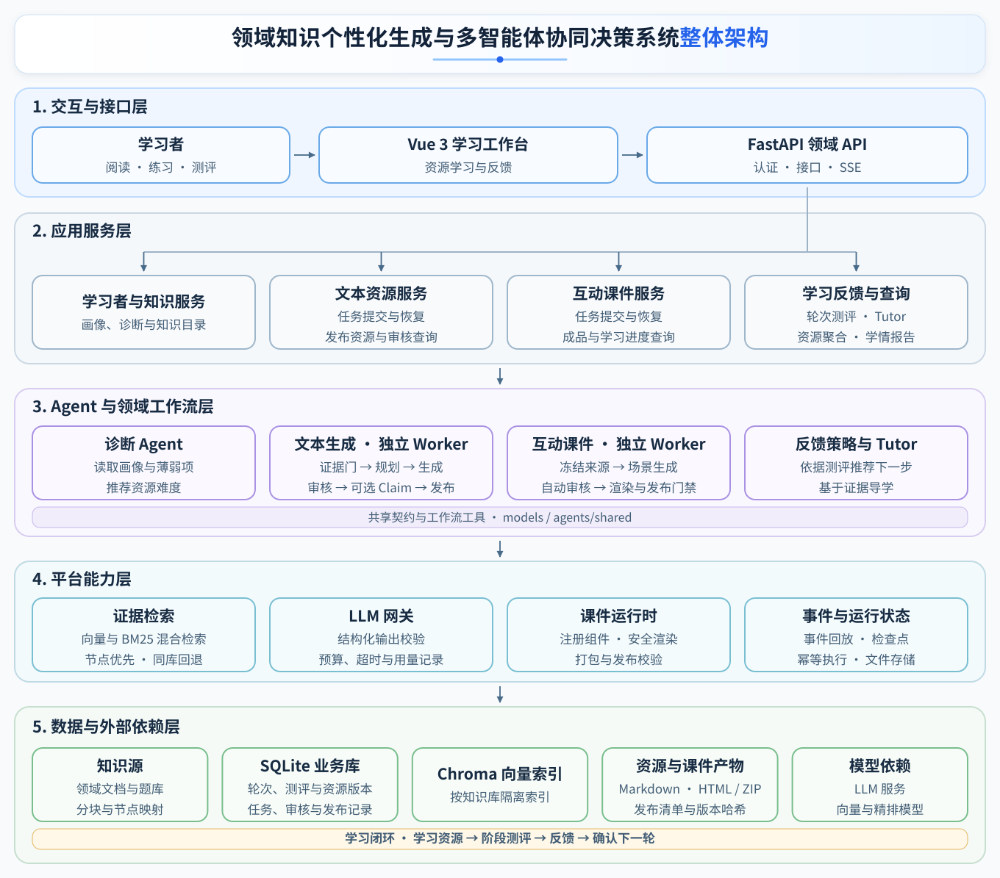
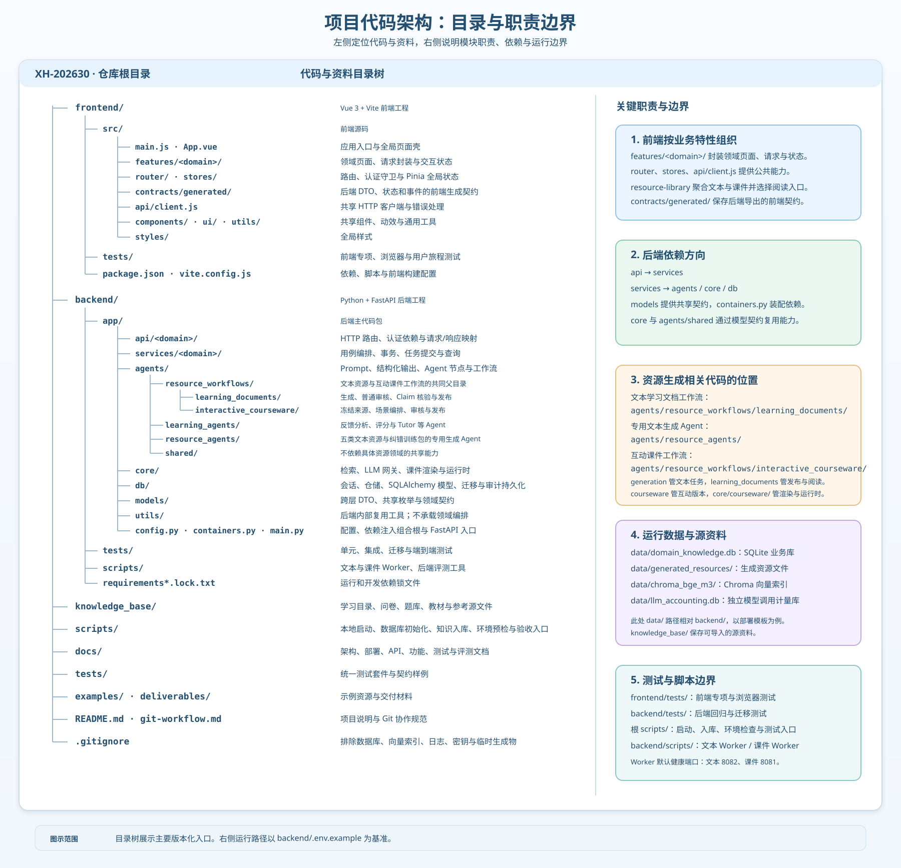
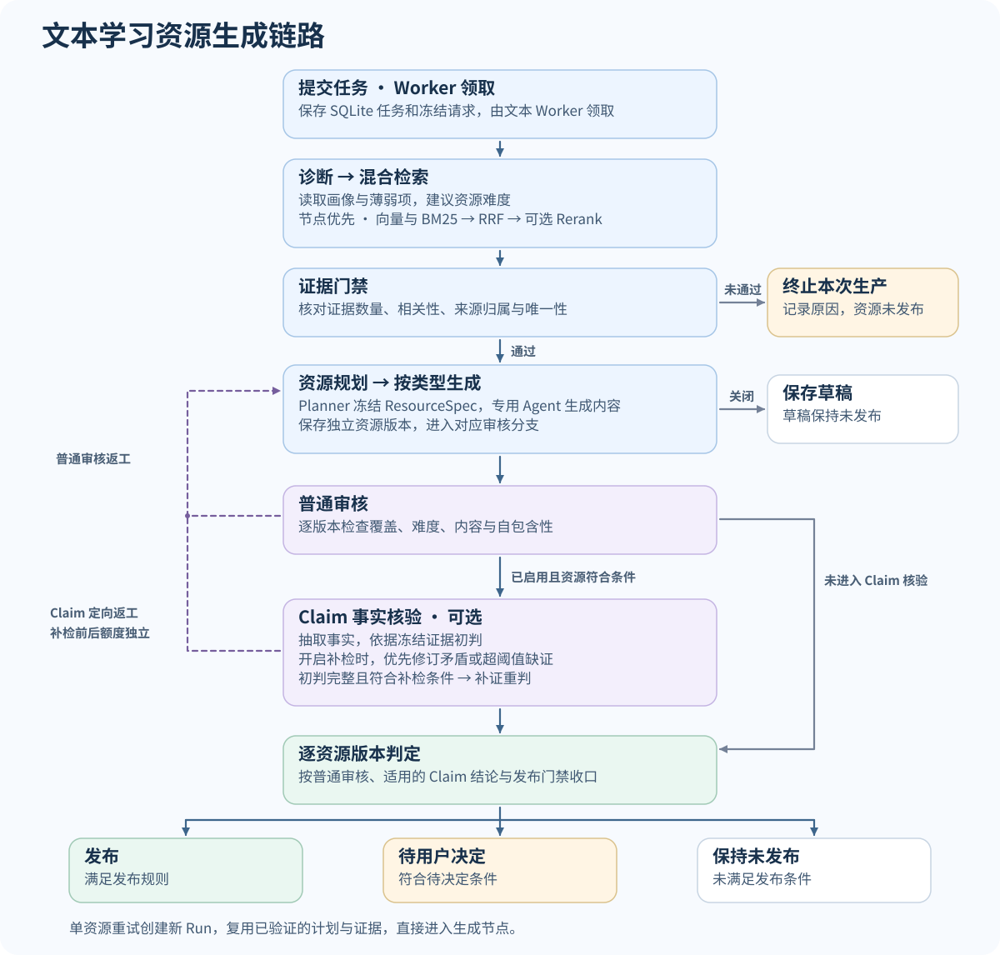

# 系统架构

## 分层与模块

`main.py` 组装 FastAPI，`containers.py` 装配依赖。`generation` 管文本任务，`learning_documents` 管发布后的文本及阅读，`courseware` 管互动版本。`feedback`、`tutor` 和 `reports` 使用已发布资源与学习事实。共享层通过模型契约复用，不反向依赖领域业务。

## 文本生成与发布

1. **任务创建**。服务端确认画像、知识库和节点，保存轮次、阶段和任务绑定。SQLite 文本 Worker 原子领取 Job，更新租约，并以真实 Run 记录执行事实。
2. **证据准备**。检索优先在映射到目标节点的文档范围内召回。BM25 与向量结果经融合、精排及 SQL 来源校验，无映射或证据不足时可回退到同一知识库。最终有效片段冻结为 Evidence，基础设施故障或证据不足按门禁处理。
3. **规划与生成**。Planner 冻结 ResourceSpec，专用 Agent 按资源类型生成。文本工作流位于 `agents/resource_workflows/learning_documents/`，正文模型契约位于 `agents/resource_agents/`。实操、测评、清单和纠错包的结构化内容由服务端渲染成可读文本。
4. **普通审核与修订**。默认 `resource_issue_v1` 按资源版本登记问题、受影响目标和证据。新任务冻结 `single_representation_v4`，审核模型接收适配后的内容，服务端验证产物身份、证据、位置及问题核销。
5. **Claim 核验**。支持核验的资源可启用 `neutral_estimate_v1` 与 `unified_context_v5`。程序校验目标原文，Judge 使用该审核版本的冻结 Evidence。开启补检时，`contradiction_first_v3` 先处理矛盾和当前版本超阈值缺证，之后对仍缺证且无矛盾的资源补检、冻结增量证据并重判。补检前后额度独立，修改正文重新审核。新请求普通返工默认 3 次、Claim 返工默认 2 次、补检后修订默认 0 次。
6. **逐资源发布**。程序依据普通审核、Claim 状态和发布策略确定结果。符合门槛的缺证资源可自动发布或由用户明确决定，矛盾及硬阻断保持未发布。任务查询、SSE、报告分别读持久化结果。

部署模板的缺证自动发布门槛为 95%，用户确认门槛为 85%。两个门槛均含等号，且要求普通审核通过、当前判定完整、无矛盾和硬阻断。

单份重试创建新 Run，通过冻结上下文定位源 Spec、版本和证据。已发布资源不可覆盖。文本运行开始后发生中断，以持久租约和终态对账，用户可按任务或资源重试。

详细证据和写入关系见 [知识库与数据库](knowledge_base_database.md)。

## 互动课件

`agents/resource_workflows/interactive_courseware/` 从冻结的单一来源编排场景、质量检查、修订及发布。`core/courseware/` 管注册组件、确定性渲染、运行时与打包。模型只能填版本化内容契约，平台控制可用组件、安全策略和产物。

独立课件 Worker 从 outbox 领取任务，以租约和 checkpoint 执行。身份或来源错配、危险输出、缺少必需场景时阻断发布，采用有界修订、降级或隔离。候选与 release 分离，重复投递保持发布幂等。

## 学习反馈与报告

`RoundLearningService` 管单主节点轮次及可选复习节点，阶段通过真实任务绑定关联资源。测评先冻结题组和资源身份，再在评分租约下判分。一次正式提交在同一事务保存 Attempt、节点决策、掌握证据、画像版本和路径变化。复习节点可更新自身掌握度，当前课程推进取主节点。用户确认后才创建纠错阶段或下一轮。

报告由画像、轮次、测评和资源等持久事实生成，SQLite 用 `report-read/4` 水位做缓存失效。报告 SSE 只通知快照变化，任务 SSE 按独立事件序列回放。文本和课件的模型用量从统一网关旁路写入独立计量库，未知用量单独标记。
