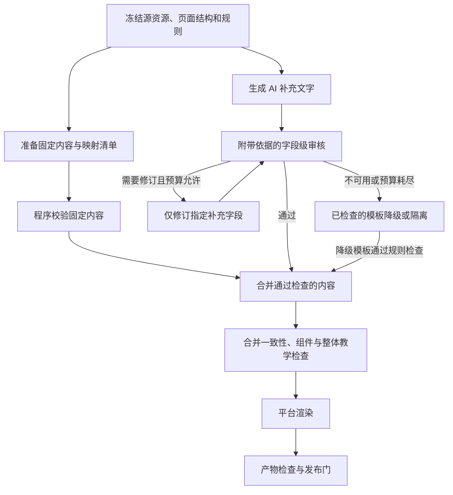

# E3：课件固定内容与 AI 补充文字分开审核

- 核验日期：2026-10-26。
- 状态：**当前路径与审核缺口已核验；方案未实施，实际质量与成本收益待验证。**
- 本次范围：重新编号并复核课件审核升级方案，仅修改方向文档及索引，不修改业务代码、Prompt、配置或数据库。
- 首版确定范围：复习课件固定内容投影校验及 AI 补充文字审核。实操课件沿用当前流程，其 AI 封面后续按同一原则扩展时另修实施计划；本版不宣称已覆盖该分支。

## 1. 用一句话说明改什么

**固定内容由程序检查是否完整、对应正确；AI 新增文字在合并前对照依据单独审核；合并通过后再渲染，发布前检查最终产物。**

当前已经基本遵循“生成结构化内容 → 审核 → 渲染”的顺序。此次升级针对审核对象和依据，不是把渲染从流程前面移动到后面。

例如，复习题目和答案直接来自已发布复习清单，课件只负责正确呈现；模型额外生成的“整体总结”则需要检查是否曲解知识、夸大课程范围，或者声称学习者已经掌握。两类内容不应采用同一套事实审核方式。

## 2. 当前真实链路与已有能力

```text
选择一份已发布的实操指南或复习清单
→ 准入检查、冻结资源内容和结构
→ 平台建立教学设计与页面槽位
→ Planner 生成允许补充的文字
→ compose_scenes 确定性组装页面 JSON；当前两类结构化来源主体跳过场景 AI 改写
→ 来源引用检查、教学形态检查
→ AI 教学质量审核、受预算约束的修订或降级
→ 来源图及页面质量检查
→ 平台渲染、安全及质量检查
→ 冻结发布候选、生成带 release 上下文的产物并发布
```

`compose_scenes` 组装的是组件名称、数据和来源绑定，不是生成 HTML。当前两条已准入结构化分支的补充文字主要来自 Planner；后续场景 AI 入口仍保留在框架中，但不能据此声称每页都由模型重新生成。真正的 `render_courseware` 位于内容审核之后；发布时还会按冻结 release 上下文再次渲染，不能把两次渲染误当成两轮模型生成。

| 当前事实 | 源码入口与核验要点 |
|---|---|
| 一份课件对应一份已发布源资源 | [source.py](../../backend/app/agents/resource_workflows/interactive_courseware/source.py) 的 `ROLE_BY_TYPE`、`admit_and_snapshot`；当前准入为实操指南、复习清单。批量选择由 Service 拆成独立任务 |
| 课件阶段使用冻结资料，不另建知识检索 | 同上；冻结正文、结构化 payload、来源块及版本相关信息 |
| 实操主体由平台固定投影 | [workflow.py](../../backend/app/agents/resource_workflows/interactive_courseware/workflow.py) 的 `_compose_scene` 跳过结构化实操来源的场景 AI 改写；[composition.py](../../backend/app/agents/resource_workflows/interactive_courseware/composition.py) 将 V3 步骤等映射到页面 |
| 固定渲染不等于所有文字都不是 AI 写的 | [planner_agent.py](../../backend/app/agents/resource_workflows/interactive_courseware/planner_agent.py) 可生成实操 `practice_cover`；复习分支生成 `ReviewPracticeCoursewarePlanEnrichment`，随后填入固定组件 |
| 复习题目与答案已有冻结结构 | `composition.py` 的 `_review_practice_scenes` 复用复习 payload，组织回忆、辨析、正反例、自评等页面 |
| AI 补充数据已经有独立契约 | [content.py](../../backend/app/models/courseware/content.py) 中 `ReviewPracticeCoursewarePlanEnrichment` 包含标题、导语、学习范围、学习方法、节点总结及整体总结等 |
| 现有程序审核与来源图 | [review.py](../../backend/app/core/courseware/review.py)、[provenance.py](../../backend/app/core/courseware/provenance.py) 检查结构、合法引用、组件、来源映射与快照一致性等 |
| 已有 AI 教学审核和自动处理 | [quality_reviewer_agent.py](../../backend/app/agents/resource_workflows/interactive_courseware/quality_reviewer_agent.py)、`workflow.py` 的 `_auto_review_and_revise`；有教学 rubric、场景定位、修订预算、降级或隔离 |
| 内容审核后才生成页面产物 | `workflow.py` 的 `_prepare_candidate_artifact`、[release.py](../../backend/app/agents/resource_workflows/interactive_courseware/release.py) |

这些能力应保留，不重复建设一套完整课件工作流。

## 3. 已确认缺口

### 3.1 生成有所分工，审核尚未按内容来源精准分工

当前课件先统一经过程序规则，再将整份文档的部分字段交给 AI 教学审核。没有把“固定来源投影”和“本次 AI 新写文字”作为两份独立审核对象，分别形成完整性校验与有依据的语义审核记录。

现有引用与来源图检查不能等同于语义一致性证明：字段绑定了合法来源，不代表字段表达的结论确实由该来源支持。固定内容应重点验证投影正确性，而非让模型重复自由判断已冻结答案。

### 3.2 AI 审核缺少依据，并遗漏部分应审字段

`review_courseware_quality_decision` 构造的 `safe_document` 包含标题以及场景的 `scene_id/kind/title/blocks/component_blocks/steps/options`，没有附上冻结来源正文，也未单独传入场景级 `lead/conclusion/answer/feedback`。

因此，部分 AI 补充文字可能没有完整进入审核。组件内嵌的答案、`overall_summary` 等会随 `component_blocks` 传入，不能笼统声称“所有总结、答案都漏审”。真正缺少的是对所有 AI 写入字段的明确覆盖，以及与其内容类型匹配的依据。

复习 Planner 当前输入主要是主题、节点名称、题量和页面设计，Prompt 要求生成学习引导而非扩写知识。如果后续允许总结具体知识事实，必须同时给生成器和审核器提供对应原文；不能只给节点名却要求其写出有依据的知识总结。

证据包不能只取 `source.py` 生成的复习题目 blocks：这些块主要保存题干，没有完整答案与题目依据。应从冻结的 `review_practice_payload` 读取相关题目、答案和已有依据字段；若某条 Evidence 只有 ID、没有可读取的冻结正文，不得当作已获取事实证据。首版确定为核对原资源与课程规则，不在课件链新增知识检索，也不宣称重新验证了全部知识库原始事实。

### 3.3 现有场景重试不能直接承担全部补充文字修订

`retry_scene` 对 `recap` 直接返回，对结构化实操保持内容不变；[scene_composer_agent.py](../../backend/app/agents/resource_workflows/interactive_courseware/scene_composer_agent.py) 也会跳过大部分复习页面的 AI 改写。

所以“发现总结问题后复用现有重试即可”不够准确。可以复用预算、问题记录和发布策略，但需要在 enrichment 层增加定向修订，不能反复请求本来就禁止重写的页面。

以上是源码机制缺口，不代表已发现实际课件包含错误，也未测出漏审率或幻觉率。

## 4. 建议流程



图中的分支表示职责分离，不要求第一版并行执行。固定内容或合并硬门失败时停止发布；不能靠另一分支通过来抵消失败。

### 4.1 固定内容：校验转换过程

固定内容包括实操步骤、代码、验证说明，以及复习题干、答案、题目依据等。建立源字段到页面字段的稳定映射清单，至少覆盖资源 ID、步骤或题目 ID、源字段路径、目标字段路径、预期值摘要及投影版本。

首版只实现复习字段映射。其中，冻结 `review_practice_payload.node_blocks[].knowledge_summary` 属于源内容；本次模型生成的 `review_practice_enrichment.node_summaries[].summary` 属于 AI 补充。不能因为都叫“总结”就混用校验方式。实操字段是同一原则的后续适用范围，本次不改其实行路径。

程序负责确认：

- 必需步骤和题目均有去向，无遗漏、重复、错序和错配。
- 答案仍属于原题；代码、关键操作和验证说明没有意外截断或改写。
- 同一节点的题目与知识小结没有串到其他节点。
- 只允许平台明确定义的格式转换；不要用删除标点、忽略否定词等过度归一化掩盖内容变化。

校验应独立对照冻结源 payload 与映射约束，不能仅再次调用同一组装函数、比较两次结果相同。HTML 转义等呈现变化在渲染检查中处理，不要求 HTML 字节等于原文。

### 4.2 AI 补充文字：先审核，再填入组件

优先复用现有 `ReviewPracticeCoursewarePlanEnrichment`。保留候选补充数据，不在审核前将其当成已批准内容写入最终页面。

平台枚举允许 AI 写入的全部字段，形成覆盖清单；字段归属由平台定义，不能让模型自行声明某句话属于固定内容而绕过审核。

| 字段内容 | 审核依据 | 主要检查 |
|---|---|---|
| 标题、学习范围 | 实际节点、原资源与课程目标 | 是否夸大或包含未覆盖内容 |
| 学习方法、完成提示 | 真实页面结构、交互与完成规则 | 是否指引不存在的功能，是否无依据地宣称已掌握 |
| 涉及知识事实的总结 | 对应冻结原文、结构化题目及答案 | 是否冲突、丢失前提或增加无依据结论 |
| 纯引导或组织性文字 | 教学用途与项目约束 | 是否误导；不要求每句“请先独立思考”都有知识文献证明 |

审核器返回字段定位、判定、具体问题、依据定位和修订指令。事实判定区分“有支持”“与来源矛盾”“依据不足”；依据不足不等于已经证明事实错误。混合了引导和事实的字段仍需检查其中的事实，不能因整段被标作“学习建议”而跳过。

每个非空 AI 字段必须有处理结果；若字段内含多个独立事实，必须覆盖其全部事实，不能只验证一句就批准整段。未知字段、重复或缺失结论、非法依据 ID 由程序拒绝。单批放不下时分批审核，不静默截断待审文字或关键依据。

程序可以核对字段清单与返回结论是否齐全，不能仅凭字段 ID 齐全就证明模型没有漏判字段内的事实；后者必须用标注样例评估，不承诺程序能自动识别所有语义遗漏。

### 4.3 定向修订与失败处理

- 只允许修改被点名的 enrichment 字段；按稳定节点 ID 定位节点总结，避免依赖可变数组下标。
- 修订后复审变化字段及与其有关的标题、范围、完成提示等约束，并重新运行合并校验。
- 固定内容的映射错误应修复投影逻辑或隔离；不能让模型改写原题来适配错误页面。
- 若问题来自源资料本身，记录来源问题并按策略隔离或返回上游处理，不能在课件中偷偷覆盖冻结答案。
- 模型不可用、审核结果不完整或预算耗尽时，不记为“AI 审核通过”。按现有 strict/resilient 策略处理；模板降级必须有版本、通过程序硬门，并清除未通过审核的补充字段。

### 4.4 合并与整体审核

审核通过后再调用确定性组装逻辑，把固定内容与已批准的补充文字填入已有组件。合并后再次验证：所有固定字段仍符合源数据；所有 AI 字段的最终值与批准值一致；组件、槽位和来源绑定合法。

现有整课教学审核仍承担连贯性、学习目标与交互用途等职责。第一版不直接删除这道门，也不把字段事实审核结果当成整体教学质量通过。两类问题应分别记录，避免整课建议触发冻结题目的无效 AI 重写。

### 4.5 渲染与产物检查

保留 `core/courseware/` 的组件、renderer、runtime、安全与 packaging。通过内容审核后渲染，再执行既有产物检查；若渲染前后发生文字变更、模板切换或来源更新，必须重新验证受影响的内容与映射。

当前在线 `browser_smoke_check` 是 HTML 字符串安全检查，没有启动浏览器；仓库已有真实浏览器样例测试。不得把“内容审核通过”解释为每个实际候选都经过浏览器交互验收。

实施时必须跑课件浏览器回归并验证新增场景的最终产物；是否增加每次发布的真实浏览器检查，需要单独评估时延和运行环境，不作为此次内容分类审核必须新增的生产服务。

## 5. 接入位置与最小实施范围

| 模块 | 建议职责 |
|---|---|
| `models/courseware/` | 增加版本化的字段清单、审核结论和审核输入摘要契约；沿用现有补充内容模型 |
| `planner_agent.py` | 继续输出受限的补充内容，按需提供与生成目标匹配的依据；不让模型控制组件或修改冻结正文 |
| `agents/resource_workflows/interactive_courseware/` | 在补充内容生成后、`compose_scenes` 合并前加入审核与定向修订；复用预算、网关和事件基础能力 |
| `composition.py` 与程序校验模块 | 生成固定内容映射、合并已批准文字、校验固定内容及最终绑定；不在确定性校验中调用模型 |
| `workflow.py` 的恢复、重试与发布路径 | 持久化并核对审核版本；只有通过相应门禁的候选可进入渲染与发布 |
| 现有教学审核和 renderer | 保留独立职责；必要调整审核输入与问题路由，避免重复判断或修订错误对象 |

首版只启用复习课件，覆盖现有 enrichment 的全部可展示字段，包括嵌套的节点总结和组件内的整体总结。实操 `practice_cover` 仍是已有 AI 字段，不能将其自动归为固定内容或声称已经通过本次新增审核；其升级不混入首版验收。

本方向不包含新增实操结果自动判定、增加资源类型、重新设计 Tutor、改变掌握度或新增测评。固定内容不在课件阶段重新进行全量知识检索；对照的是冻结资料及真实课程规则。

## 6. 审核版本、恢复与成本

首版确定复用已有 `courseware_specs.spec_json`，在其中新增版本化的内部 `content_review` 对象，不新增数据库列，不改变公开 DTO 或事件 payload。现有 [课件仓储](../../backend/app/db/courseware/repository.py) 已完整读写该 JSON；新增审核记录另用平台内部严格 DTO 校验，不能把“审核通过”字段放入模型可直接输出的 CoursewareSpec。

`content_review` 保存已批准的复习 enrichment、稳定字段清单和逐字段结果、依据定位、冻结输入摘要、设计规则摘要、字段值摘要、审核／映射／模型／Prompt 版本，以及尝试次数和成本。使用这些输入摘要和版本确定一次审核身份；尝试次数与成本仅供记录，不参与身份计算，日志不保存用户原始敏感数据。

设计规则摘要只计算冻结 `learning_design/storyboard/design` 与规则版本的规范化投影，排除 `content_review`、补充文字、自身摘要和最终 spec 的 `content_hash`。补充文字单独计算值摘要，最终持久化对象再计算整体 hash，避免循环依赖。

现有快照 `content_hash` 针对来源正文计算，结构化复习 payload 及其 hash 独立保存。新审核身份应覆盖实际送审的规范化 payload 和依据内容，或经程序核验覆盖这些内容的摘要，不能只沿用 Markdown 的 hash。

- 同一输入重试可复用已完成且身份一致的审核；实际采用的冻结快照、文字、规则或契约变化后，相关结果失效。上游资源后续编辑不得在恢复时偷偷替换当前冻结快照，也不追溯修改旧 release。
- 持久化批准后的 enrichment 与审核身份，不能只保存“这个任务曾经通过”。恢复到 `design/scenes` 检查点时仍需核对；旧检查点没有新审核记录，不能自动视为已通过新门。
- 当前 `_prepare_spec` 的 `spec_json` 未保存复习专用 `review_practice_enrichment`；设计恢复时 `plan=None`，只读取普通 `enrichment`，而复习组装从 `plan.review_practice_enrichment` 取值。设计完成、场景未完成时恢复可能丢失复习补充文字。实施时应先持久化批准值及其审核绑定，再完成对应检查点，并在恢复时显式加载；不能默认文案替换后仍沿用旧结论。
- 现有检查点自身 hash 校验不能证明新字段审核已经完成；审核记录身份、候选值摘要与实际送审输入摘要必须相互对应。`_prepare_spec` 先持久化批准值和 `content_review` 再完成 design 检查点；恢复后显式加载批准值供 `compose_scenes` 使用，不依赖已为 `None` 的 plan。
- `_run_workflow` 复用 scenes、`_persist_approved_scenes` 写入场景，以及候选准备、定向重试、模板降级和 release 冻结前，都须核对同一审核身份与实际字段值；design/scenes 检查点同步绑定该身份。不能只检查首次生成路径。
- 字段顺序、依据顺序稳定；重试、修订及恢复共用现有总 token、时限和费用预算，不为新审核建立无限额循环。
- 固定内容程序检查不增加模型调用；少量补充字段可以批量审核、按关联裁剪证据，但必须保持覆盖完整。
- 第一版保留整课教学审核时，新增字段审核可能增加一次调用。是否净省费用必须比较总 token、调用次数、修订率及降级率，不能仅凭输入更短就承诺降本。

模型或审核 Prompt 的变化也应纳入版本管理。没有 AI 补充内容时记为“不适用”，不能伪造一次 AI 审核通过。

新增审核策略以服务端开关控制，默认关闭并在运行内部记录策略版本；启用前完成首版验收。未发布的旧检查点进入新策略时，使用其冻结输入补齐审核；无法恢复完整待审文字时，按既有 strict/resilient 规则使用经过检查的模板或隔离，不能把缺失记录补写成“通过”。关闭策略不改已发布产物，也不把新旧审核结论混用。

## 7. 兼容边界

- 保留一源一课件、实操 V3 与复习 V2 结构化输入、既有页面顺序和学习交互语义。
- 保留公开 HTTP/DTO、认证、事件 payload 和发布幂等行为；新增内部审核信息使用版本化 `spec_json.content_review`，同步严格读写、检查点和回滚验证，无需数据库迁移。
- 不引入人工审核工作台；未知来源、组件、危险内容和缺失必需内容仍是发布硬门。
- 不允许模型输出 HTML/CSS/JavaScript、URL、任意组件名或可执行修订代码。
- 保留现有已发布产物；重试不能覆盖旧 release，也不能使用新内容复用旧审核结论。
- 如果实施触及共享能力，按仓库要求补做文本工作流回归；本次文档不改变五类文本资源的生成、审核和发布行为。

## 8. 如何证明升级有效

### 必要反例与通过标准

| 验证场景 | 应达到的结果 |
|---|---|
| 固定题目被漏掉、答案串题、代码被截断 | 程序校验阻止发布，不依赖模型猜测 |
| AI 总结引用合法，但把“需要验证”改成“必然成功” | 在配套固定判定 fixture 中准确路由到该字段并阻止未经修订的值发布；真实模型识别率另测 |
| AI 在 `lead/conclusion` 或嵌套 `overall_summary` 中加入无依据内容 | 覆盖清单包含这些字段；不存在因位置不同而跳过审核的路径 |
| 审核遗漏一个字段、漏掉多事实中的关键句、返回未知依据 | 结构及覆盖不完整不得进入“通过”状态；语义漏检用人工标注评测集统计 |
| 纯学习引导，如“先独立回忆” | 按教学规则处理，不误要求知识文献；混入事实时仍检查事实 |
| 某个节点总结需要修改 | 仅对应 enrichment 变化，固定题目、答案和其他无关字段不变 |
| 审核后修改文字、来源或规则，再断点恢复 | 不复用失效的批准记录；重试不重复发布 |
| AI 审核超时、输出无效或预算耗尽 | 显式 unavailable、模板降级或隔离；不冒充通过 |
| 正常渲染及交互 | 固定内容正确显示，答案揭示、自评及状态恢复符合既有契约 |

确定性测试能证明字段覆盖、路由、失败处理和发布约束，不能证明模型语义判断正确。正式比较时，对同一组冻结样例测当前方案与升级方案的无依据内容漏检率、误报率、审核覆盖率、修订成功率、输入/输出 token、总调用次数和时延。不能只比较发布率，也不能宣称“零幻觉”。

### 后续实施的验证入口

按[仓库约束](../../AGENTS.md)和 [README 测试运行](../../README.md#测试运行)，互动课件实现至少覆盖单元、集成、e2e、冻结评测与浏览器。正式计划应选定相关领域用例；以下为当前已有入口，**本次文档任务没有运行这些业务命令**：

```powershell
python scripts/run_tests.py --list
python scripts/run_tests.py --suite courseware-eval
npm --prefix frontend run build
npm --prefix frontend run test:courseware-browser
```

真实模型评测只有用户明确要求且环境提供预期凭据时才启用；本次未启用 `RUN_LIVE_LLM` 或 `COURSEWARE_LIVE_EVAL`。浏览器样例通过不等于每份线上课件已经通过交互验收。

## 9. 参考依据与本次验证范围

[Ragas Faithfulness 官方说明](https://docs.ragas.io/en/latest/concepts/metrics/available_metrics/faithfulness/) 将生成陈述与给定上下文对照，判断是否得到支持。本方向借鉴这一思路，仅对实际 AI 新增内容进行有依据的审核，不要求引入整个 Ragas 依赖，也不把其分数直接作为项目发布保证。

与 [E2](E2-claim-extraction-coverage.md) 的关系：E2 改进文本通用 Claim 抽取的中立性，本方向使用课件已有结构化字段清单，不直接复用文本 Claim 链，也不为 E2 增加已排除的遗漏复核。与 [E1](E1-resource-aware-retrieval.md) 的关系：E1 优化上游文本资料选取，本方向核对已发布资料的课件转换，不能替代原资料审核，也不在课件阶段重新检索。

本次验证范围：对照当前工作树源码核对路径、合同与调用顺序，检查文档本地链接、命令入口和状态表述，并进行独立文档复核。未修改实现、未执行课件业务回归、未调用真实模型、未测量质量或成本变化。

正式实施前，应在 `docs/update_plan/T<N>.md` 建立计划并通过门禁，细化已确定的 JSON 持久化读写次序、审核版本失效规则及预算分配。本文是方向依据，不自动授权业务实现。

2026-10-26 复核：调整为 E3；明确首版复习课件范围、两类总结的来源区别，确定复用既有 `spec_json` 持久化审核与批准值。配置开关及预算说明随实现同步 README、部署文档和 `backend/.env.example`。本次只确认升级接入依据，尚未证明生产可用性或模型审核收益。
