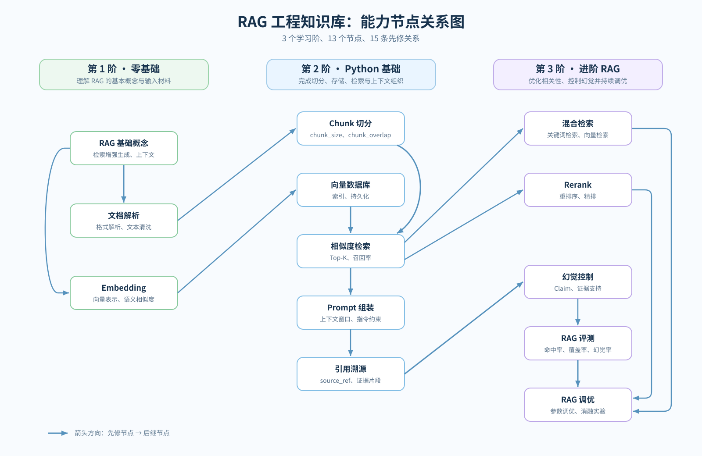
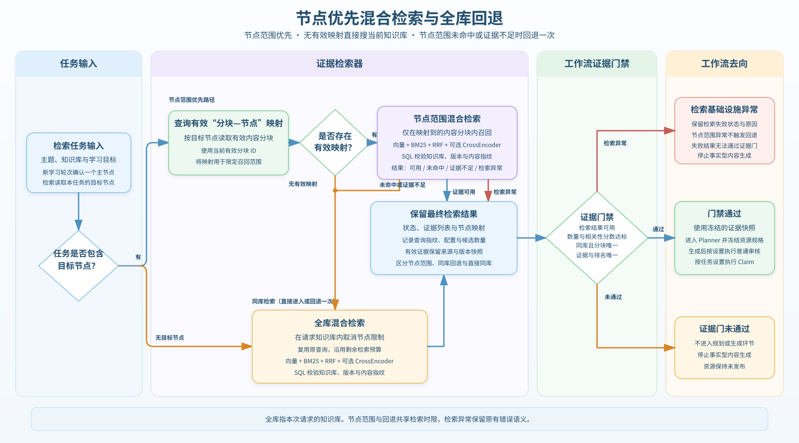

# 知识库与数据库

## 源文件

| 资产 | 仓库入口 |
|---|---|
| 学习领域、方向与知识库映射 | [learning_catalog_seed.json](../knowledge_base/learning_catalog_seed.json) |
| 默认 RAG 方向的文档、分片规则、技能节点、先修边和模型配置 | [metadata.json](../knowledge_base/rag_engineering_training/metadata.json) |
| 教材、参考资料、许可与版本来源 | [RAG 资料目录](../knowledge_base/rag_engineering_training/README.md) |
| 问卷、诊断题、测评题 | `knowledge_base/` 下的问卷源和方向内题库 |

问卷采集学习目标、学习方式、难度偏好和时间预算。身份、学历、经验等稳定资料保存在用户档案。诊断题建立定阶和初始证据，正式测评结果单独保存。

## 入库与索引维护

Git 管理源文件和元数据。实际 SQLite、Chroma、模型缓存和生成资源由运行环境维护，首次安装见 [部署指南](deployment.md)。

从项目虚拟环境在仓库根执行需要的操作：

| 操作 | 命令 |
|---|---|
| 核验源资料和注册表 | `python scripts/prepare_knowledge_sources.py --check` |
| 初始化关系表、学习目录、问卷、题库和示例数据 | `python scripts/init_db.py` |
| 入库配置指定的默认知识库 | `python scripts/ingest_knowledge.py` |
| 按仓库中已知知识库显式入库并对账 | `python scripts/ingest_knowledge.py --knowledge-base-id rag_engineering_training` |
| 检查数据库完整性 | `python scripts/check_database_integrity.py` |

入库维护先停写并成组备份 SQLite 和 Chroma。SQL 保存不可变文档版本和片段，Chroma 按知识库保存对应向量。换 Embedding 模型时使用匹配模型的独立索引，验证片段身份、索引对账和检索结果，再切换运行配置。已冻结 Evidence 仍绑定检索当时的文档版本和摘录。

## 持久化关系

| 领域 | 主要事实 |
|---|---|
| 知识 | 领域与方向、知识库、文档版本、片段、能力节点与先修关系 |
| 画像 | 用户资料、方向问卷、诊断、画像版本、节点掌握度与课程进度 |
| 轮次 | `learning_rounds`、成员、阶段和任务绑定。任务、阶段、批次各自有身份 |
| 测评 | `learning_round_evaluation_sessions` 按 `(stage_id, ordinal)` 保存会话。每个会话最多一个正式 Attempt，按成员存评分与节点决策 |
| 文本 | Generation Job、AgentRun、步骤、Evidence、资源 Spec 和版本、Review、Claim 及发布状态 |
| 课件 | 任务与 outbox、冻结来源、场景与审核、不可变 release、学习事件及投影 |
| Tutor | 源资源上下文、会话、轮次、受控证据引用 |
| 计量 | 独立 SQLite 库，记录调用、分段和安全聚合，与业务库分离 |

## 迁移和公开边界

迁移入口是 [数据库初始化](../backend/app/db/shared/database.py)。`p0_40_correction_package_json` 增加纠错规范包与哈希的私有列，`p0_41_round_retake` 允许同阶段多次冻结测评。SQLite 的 `report-read/4` 水位在相关事实变化时使报告缓存失效。水位和索引属于派生数据，学习记录、资源版本及发布指针是业务事实。

私有测评答案、评分细则、结构化纠错包和审核内部账本在仓储中保存。公开读取经过归属检查与专用投影，数据范围见 [API 指南](api.md)。
